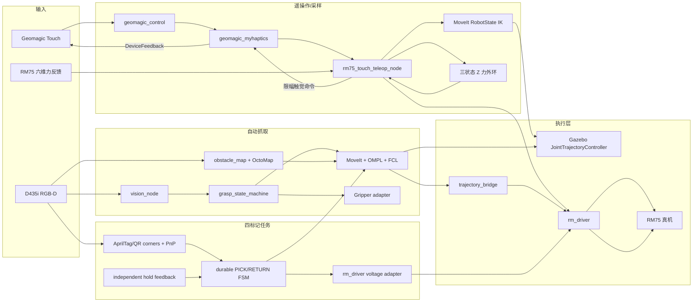

# PROJECT_FOR_CHATGPT

## 2026-10-28：RM75 手动路径示教与可复用轨迹资源

【路径示教】Web 新增独立“路径示教”页面。操作员每次点击只记录一个新鲜实际反馈点，包含
固定顺序 joint1–joint7 的 rad 值、`base_link → Link7` 的 m/四元数位姿、关节与 TF ROS
时间戳、稳定点位 ID 和序号；支持选择、删除、上下移动和清空。浏览器只调用 FastAPI，不直接
读写服务器文件。

【严格过点轨迹】轨迹模块使用非零单调结点速度、反向关节零结点速度和共享零结点加速度的
分段五次 Hermite，多段位置/速度/加速度连续。原始示教关节向量在密集轨迹中逐点原样替换，
不会被平滑器改变。段时间由 URDF 速度限制、配置加速度限制及页面比例初始化，再按密集采样
极值迭代缩放；生成后逐点检查关节限位和 MoveIt/FCL 当前碰撞场景。

【资源与执行】版本化 `RM75Trajectory` JSON 同时保存原始 waypoints、生成后的 positions /
velocities / accelerations / time_from_start、配置和状态，默认原子写入
`~/.ros/rm75_sampling_gui/trajectories/`。资源以稳定 trajectory_id 管理，提供 CRUD、重新
生成、执行、停止和实际反馈进度 API。执行复用既有 TaskManager、JointControlAdapter 和
`/rm75_sampling_gui/follow_joint_trajectory`，没有新增 JointPos 发布者；SIMULATION 复用相同
API 且无物理输出。

【恢复审查修复】创建资源时重复 ID 原子拒绝；停止事件贯穿排队、校验和 Action 等待；
回返轨迹进度沿当前段匹配实际反馈。既有受控 Action 服务与仿真现在消费完整速度/加速度并
重建五次插值，避免执行时退化为线性插值。仿真急停保持 SAFE_STOP；保存相同参数保留 READY，
页面改参数后禁止执行旧轨迹。详见 `rm75_sampling_gui/docs/web/WAYPOINT_TRAJECTORY_VALIDATION.md`。

【本轮验证】`rm75_noetic` 容器中的轨迹与现有功能非 rostest 回归为 179/179 通过；catkin
Release 构建共 15 个依赖包全部成功，rostest/catkin 汇总为 90 tests、0 errors、
0 failures、0 skipped；React TypeScript 检查和 Vite 生产构建通过。构建存在既有依赖的
CMake/Gazebo 弃用提示与 Vite 大包警告，不影响通过结果。统一
`start_sampling_web.sh --mode simulation` 入口完成黑盒验证，覆盖轨迹采集、生成、取消、按稳定
ID 重复执行以及原有笛卡尔、Touch、工具、安全停止和相机链路。路径示教页已在实际构建产物中
完成浏览器目视检查。上述结论均为 SIMULATION 软件验收，本轮没有连接或移动真实机械臂；真机
执行前仍须按现场流程复核工具、碰撞场景、控制器限制和急停。

## 2026-10-27：Web 操作流程与安全修复补录（对应 2026-10-26 源码，最新增量）

> 本节记录当前工作区在 2026-10-26 完成、但此前未写入本文的修改。若与下方
> 2026-10-24 的“Tool5 力控螺旋钻取土”联动流程冲突，以本节和当前源码为准；旧段落继续
> 保留为历史实现记录。

【Tool5 当前改为电机与机械臂分离控制】`gui.yaml` 当前启用
`tool5_drill.motor_only=true`、`require_force_feedback=false`。采样硬件页已移除下降距离输入，
“开始连续旋转”只启动 DM-J4310 连续进程，状态由 `STARTING` 进入 `ROTATING`，不会切换
RM75 控制链路、启动垂直下压节点或发布机械臂运动命令。电机旋转期间，操作者可另行进入
“实时力监控”页启动“独立垂直下压力控”；停止旋转只停止并回读确认电机，不会替操作者停止
独立的机械臂力控，二者必须分别操作。软件急停、控制租约丢失或底层电机故障仍会进入
`SAFE_STOP` 并尝试停止两侧。已完成的旋转任务可直接再次启动，不再要求手工复位状态机。

【网页控制入口调整】实时力页面当前重新以普通 Touch 位置遥操作为主，灰键控制平移、白键
控制姿态，不在该入口启用 Z-only 触觉闭环；页面同时保留独立垂直下压力控按钮。后端兼容命令
仍在，但当前 UI 不再把旧的“Z 力位 + Touch 力反馈”作为主入口。Tool5 电机处于 `ROTATING`
时只允许切换到独立 `z_force` 控制路径；其他活动 Tool5 状态仍禁止自动切换控制源。

【Tool5 启动竞态与输出屏障】连续电机启动新增取消事件、输出锁和底层进程注册确认回调，
把“租约检查/安全停止”和“连续进程成为可停止对象”串行化，避免停止命令先完成、随后在途
启动又把电机打开。无输出的 `STARTING` 阶段不再被网页轮询误判为运行期反馈超时；一旦电机
注册完成，控制租约和 KEEPALIVE 检查立即生效。旧的联动兼容路径还会在既有
`feedback_timeout_s` 内等待 driver、joints、TCP，以及仅在配置要求时等待 wrench；Z 进给命令
必须收到命令订阅者并取得新的 `DRILLING` ACK 后才允许启动电机，超时或底层 `SAFE_STOP`
都会拒绝继续。当前 `motor_only` 路径只预检电机通信，不把 RM75 或六维力反馈错误地作为
电机独立旋转的启动条件。

【垂直进给兼容层】底层 `rm75_vertical_press` 新增可选
`tool5_require_force_feedback`。关闭时，旧 Tool5 深度接口从当前实际姿态按专用
`max_z_velocity` / `max_z_step` 做单调、有界的位置进给，不使用较快的手动双键下压速度；
开启时才进入从当前姿态开始的力控进给并强制检查力反馈。两种模式仍保留关节反馈、关节限位、
跟踪误差、IK、最大行程和现有力数据可用时的超力保护。该兼容层不是当前网页 Tool5 的默认
操作方式，也没有完成新的真机进给验收。

【机械臂 0x1016/4118 软限位工具】故障诊断页新增“查询限位”和“修复限位”。查询为只读，
不要求控制租约；修复必须取得 Web 独占租约、通过二次安全确认，并在 OFFLINE/SIMULATION
中禁用。统一启动脚本会把固定的 `realman_limit_recovery.py` 暂存进容器，并将同一
`RM75_ARM_IP` / `RM75_ARM_PORT` 传给它；网页不能提供脚本路径、控制器地址或任意命令。
默认诊断以控制器回读的软限位为准，距限位 5 deg 内视为需恢复，目标退到 10 deg 裕量，
恢复速度为 5%。执行前要求没有非 4118 系统错误、没有关节错误且所有关节已使能；之后只清除
4118、发送一次有界 `movej`、等待轨迹完成并重新读取限位和错误状态。并发查询/修复由进程锁
拒绝。该修复会真实移动机械臂，当前仅完成接口与软件测试，不能视为真机脱困验收。

【控制链路与状态修复】自动切换控制路径若在新路径启动中失败，会优先恢复原路径及原先由
Web 持有的子系统；只有恢复原路径也失败时才回退到 `observe`。`qr` 与 `pose` 两种 launch
共享 `/rm75_five_target_server` 时，未激活的别名不再被误报为外部进程；真正的非 Web
命令源仍会阻止切换。二维码服务已经离线时，“终止任务”现在幂等返回“已停止”，不再等待
一个不存在的服务。取物后是否持物继续由 `holding_slot` 独立记录，操作状态保持 `IDLE`，
相关状态变化已同步到仿真校验和实验日志。

【IK、权限与现场配置】笛卡尔 IK 现在以最终有限残差和显式关节边界作为成功条件；即使
SciPy 因达到迭代次数返回 `success=false`，只要位置误差不超过 6 mm、姿态误差不超过
0.08 rad 仍可接受，并额外返回优化器状态供诊断，误差超限仍拒绝。七轴执行/取消、普通恢复
和软限位修复按钮在没有有效控制租约时禁用。`base_real.launch` 当前 UDP 本机地址默认值已改为
`192.168.5.100`；“前伸”“收拢”预设也已替换为当前保存的 Link7 位姿。此前本文记录的
`192.168.1.100` 只代表当时真机验证环境，启动前必须按现场网卡重新确认；本次没有验证新的
UDP 地址或两组预设姿态。

【本轮软件验证】在 `rm75_noetic` 环境中，Tool5、软限位 API、任务管理、控制路径和状态机
相关 Python 回归为 111/111 通过；`rm75_vertical_press` Release 构建及依赖构建成功且无编译
警告，catkin 汇总为 12 tests、0 errors、0 failures；React/TypeScript/Vite 生产构建成功，
仍有既存的大 chunk 性能提示。验证全过程没有连接或移动真实机械臂、电机、水泵，也没有执行
软限位恢复；Tool5 分离操作、真实急停/断联、限位脱困、UDP 新地址和新预设均需现场分阶段验收。

## 2026-10-25：DM 电机命令限流参数修复与运行时长调整

【已修复】电机命令先前把 `OC_Value` 错当成安培值，直接写入 1.5；该寄存器
实际是 `(0, 1)` 的满量程电流比例，因此固件拒绝并报 `Failed to apply 1.5 A`。现在
根据电机回读的极对数、磁链、减速比、传动效率和物理 TMAX 计算输出轴转矩常数与
满量程电流。最终依操作员确认使用 4 A / 15 N·m 高力矩档，换算为 `OC_Value=0.544148`，
写入后同时回读验证电流比例、VEL 模式和 15 N·m TMAX。预检也兼容旧版 5 N·m 挥发限值，
首次新命令会将其升级到 15 N·m，后续命令不再
被误报为出厂 28 N·m 配置不匹配。同时修复了厂商 u2can SDK 参数回包跨串口分片时未拼接
的问题，并避免每次命令打印误导性的 `Serial port is open`。

【验证】新增分片回包和安培到 OC 比例换算测试；Web 后端相关回归 26/26 通过。真机在
全程失能、不转动条件下完成高力矩参数写入与回读：`mode=3`、`current_limit=4.000A`、
`OC_Value=0.544148`、`TMAX=15.0N·m`。本轮没有使能或转动电机，机械运动仍需在清空工作区后
由操作员低速验收。

【运行时长】普通 `forward` / `reverse` / `dig` 的单次有界时长由 10 s 提高到 60 s，并将
后端子进程等待上限改为“请求时长 + 5 s 安全停止余量”，避免仍被旧的 15 s 隐藏超时中断。
Tool5 “开始取土”仍使用无固定时长的 `dig-continuous`，直到操作员停止或心跳、超速、
超速、高力矩硬限等安全保护触发。土壤阻力不固定，已取消 2 s 低速/堵转自动停机；正常
通信与心跳保持时，Tool5 持续旋转到操作员主动停止。

## 2026-10-24：RM75 Tool5 力控螺旋钻取土

【已实现流程】Web“采样设备”页新增 Tool5 控制区，包含下降距离（cm）、“开始取土”、独立
“停止旋转”、实际下降距离、Fz、力矩合量、电机/Z 进给状态、任务状态和故障原因。状态机
区分 `IDLE`、`STARTING`、`DRILLING`、`DEPTH_REACHED`、`STOPPING_MOTOR`、
`COMPLETED`、`SAFE_STOP`。启动不寻找土面；前提是操作者已让钻头接触土壤。到达深度时
机械臂停止 Z 进给并持续发布当前实际关节保持命令，电机继续旋转；用户点击
停止旋转后，先冻结 Z，再抢占电机进程，随后重新读取状态并确认速度不高于 0.05 rad/s，
完成后不回撤。

【机械臂与深度】钻进复用 `rm75_vertical_press` 和 `HybridForceControl`，新增“已接触直接进入
CONTACT_MODE”的小接口，没有新增 `/rm_driver/JointPos` 发布者。钻进专用 launch 与现有
七轴、trajectory bridge、Touch、普通力控源互斥。启动时从 MoveIt 实际状态记录 Link7 Z，
每周期按 `start_z - actual_z` 计算实际深度；目标深度、独立 50 mm 最大进给行程、力控自身
行程、速度/步长、关节跟踪、IK 和六维力保护同时生效。到深度后使用实际反馈姿态保持，不按
目标指令累计深度，也不生成回撤动作。

【力与安全】专用预配置为 -10 N 目标力、5 mm/s 最大 Z 速度、60 N Tool5 轴向力上限、
15 N·m 六维力矩合量上限、0.25 s 底层力反馈超时；继续复用既有 `UdpSixZeroForce`、
`force_sign=-1`、力坐标检查、滤波、关节跟踪和 Emergency Stop ACK。浏览器租约/心跳丢失、
六维力/关节/TCP 过期、非有限数据、超力/超力矩、跟踪异常、底层 SAFE_STOP、电机异常或
停止失败都会停止电机和机械臂进给并锁存 `SAFE_STOP`。上述参数是保守的预验收值，不代表
旋转钻土闭环已通过真机验收。

【DM-J4310 连续旋转】普通 `forward`、`reverse`、`dig` 按钮保持单次 `<=60 s`；Tool5
专用流程改用一个 `dig-continuous` 底层进程，没有固定 10 s 截止时间，也不通过循环重发短命令
绕过限制。连续进程要求父进程每 1.0 s 内通过专用管道发送新鲜 `KEEPALIVE`；Web 租约失效、
后端退出导致管道 EOF、心跳超时、串口/CAN 故障、1.5 rad/s 超速或 15 N·m 力矩硬限时，
底层 `finally` 都会执行零速和失能。每次启动写入和回读 VEL 模式、4 A 电流限制与
15 N·m 力矩限制；独立“停止旋转”仍能 terminate/kill 活动进程并在停止后重新读取速度确认。
该内部连续命令不能从普通 Web 电机命令入口调用，只能由 Tool5 状态机在独占控制租约内持有。

【TCP 与授权边界】项目只有经使用的 `base_link -> Link7`，没有已测量的 Tool5 钻尖 TCP
偏移；本次没有猜测偏移，状态明确显示 `tcp_calibrated=false` 和待标定。由于钻进过程中姿态
锁定，固定 TCP 的相对 Z 位移与 Link7 相对 Z 位移相同，但钻尖绝对位置仍不可声称已标定。
统一入口 `start_sampling_web.sh` 不再要求终端确认，启动后仍需取得 Web 独占租约，并在网页
操作台选择 Tool5 路径。路径切换不会
自动启动运动源。旧实时脚本仅作为兼容包装保留。没有运行真机钻土。

【修改与验证】主要改动位于 `rm75_touch_teleop/hybrid_force_control.h`、
`rm75_vertical_press` 节点/launch/config、`rm75_sampling_gui` 的 TaskManager、ROSInterface、
Web 后端 `tool5_drill.py`、React 采样页、启动授权脚本和相关测试；前端生产 `dist` 已重建。
Release 构建三个相关包全部成功且零编译警告；ROS 回归结果为
`rm75_touch_teleop 57/57`、`rm75_vertical_press 6/6`、`rm75_sampling_gui 73/73`，Web 专项
`17/17`，React/TypeScript/Vite 生产构建成功。自动化覆盖到深度后 Z 保持而电机继续、人工
停止后 `COMPLETED` 且不回撤、超力、超力矩、反馈过期、跟踪异常、电机停止失败、专用命令源
互斥和 Web 层不发布 JointPos。

【未解决/真机待办】Tool5 钻尖偏移需实测标定；-10 N/5 mm/s/60 N 参数、传感器零偏与
坐标变换需在固定柔顺介质上重新确认；现有接触恒力闭环尚未完成旋转土壤真机验收；DM-J4310
停止状态、堵转、电流/力矩与 RM75 保持精度还需断使能、空载、柔顺介质、实体急停和通信拔线
分阶段验证。连续运行看门狗目前只完成软件仿真和进程级自动化验证，尚未做真实 CAN 断线、
后端 SIGKILL、长时间热负载与实体急停验收。

## 2026-10-24：近期代码功能补录（对应 2026-10-21 更新）

### 五工具配置、二维码取物与自主写点取物

【已实现】Web 导航现将“二维码取物”和“自主写点取物”拆成两个独立流程，避免两种目标
来源互相覆盖。二维码流程使用公共 AprilTag ID 0、既有手眼/机架标定和五槽位变换，依次
提供识别、计算五目标、目标预览、MoveIt Dry Run、确认取物、归还和终止；自主写点流程只
读取 `rm75_sampling_gui/config/tools.yaml` 中 Tool1--Tool5 的绝对
`base_link -> Link7` 位姿与垂直抬升高度，不读取二维码计算结果。

【自主写点安全链】五组位置、RPY 和 Lift Height 可在网页编辑，并以原子替换方式持久化。
执行前必须先通过 MoveIt 可达性、关节限位、自碰撞以及完整严格 Z 向路径检查；动作顺序为
运动到 `Z+H` 预抓取位姿、保持姿态沿基坐标 Z 下降、发送既有 24 V 末端动作并等待新 ACK、
保持姿态沿 Z 抬升 H、原位保持。Dry Run 后若配置或机器人起点变化，正式执行会拒绝使用旧
规划。项目没有独立物体在位传感器，因此成功状态为 `COMPLETED_UNVERIFIED`，只表示运动和
24 V ACK 完成，不把它表述成“抓取成功”。

【二维码任务状态修复】SIMULATION 已补齐二维码流程的顺序约束和持物状态：未计算目标时
拒绝规划，必须为当前工具完成 Dry Run 才允许执行；取物后回到可操作的 `IDLE` 并模拟 24 V，
“终止任务”只取消运动而不会错误清除持物事实；只有归还完成后才清除持物状态、回到
`IDLE` 并复位为 0 V。软件急停会清除未执行的规划，恢复后即使仍持物也回到 `IDLE`，
持物事实继续由独立的 `holding_slot` 记录，不阻止启动 Touch 遥操作。

【验证】React/TypeScript 生产构建通过；浏览器检查确认两个独立入口、五工具配置表单、
实时位姿和 0--6 步状态正常。SIMULATION 黑盒已覆盖二维码
识别/计算/预览/规划/执行/取消/归还的完整顺序，以及自主写点 Tool1 Dry Run 和执行；无
物体传感器时会保持 `grasp_confirmed=false`。当轮 `rm75_qr_task` 为 30 项测试通过，
`rm75_sampling_gui` 为 71 项测试通过，两个包 Release 构建成功。上述结果不是五工具真机
抓取验收；仍需断使能规划、空载低速单工具、真实碰撞场景、实体急停和末端负载验证。

### Web 采样硬件页与受限设备控制

【已实现】Web 新增采样硬件页面，通过后端单一所有者访问三路 RS-485 水质传感器和继电器：
显示 EC、EC 温度、ORP、pH、各设备健康状态、总线统计、继电器位图和更新时间。水泵固定在
继电器第 4 路，开关命令先读取当前 8 路位图，只修改第 4 位并保留其他七路状态；继电器状态
未知时拒绝写入，平台关闭或软件急停时会尝试关闭水泵。

【电机控制】DM-J4310 普通手动区只开放 `forward`、`reverse`、`dig`、`stop`、`status` 白名单，运动
速度限制为 `<= 1.0 rad/s`、持续时间 `<= 60 s`；Tool5 专用连续命令见本文顶部最新增量。底层在运动前强制并回读 VEL 模式、
4 A 电流上限和 15 N·m 力矩上限；后端串行化电机进程，拒绝并发运动，`stop` 可中断活动
命令并执行停止/失能。页面显示位置、速度、力矩、通信和安全配置回读状态，不能把未回读的
参数标成已验证。

【授权与启动】统一的 `scripts/start_sampling_web.sh` 不再提供终端模式菜单或确认输入，直接
启动统一网页。之后仍要求
浏览器取得独占控制租约且心跳有效，并在全部控制子系统停止时选择唯一活动控制路径；
普通观察模式只能监视。该入口在启动前检查 RM75
`192.168.1.18:8080` 连通性，将经过审查的 Modbus、电机控制、DM-CAN SDK 和 pyserial 文件
暂存到工作区内固定目录，然后选择与其他控制源互斥的受控七轴路径。网页没有任意串口、
CAN 或 shell 透传接口。

【仿真与测试边界】内存仿真会生成变化的 EC/温度/ORP/pH 数据，并覆盖水泵开关、电机
白名单、速度越界拒绝、活动命令中断、SAFE_STOP 下设备命令拒绝以及急停关闭水泵；仿真
不访问串口/CAN，也不产生真实输出。当前证据证明页面、授权门、白名单和软件边界按代码
工作，不等同于三路探头标定、水泵负载、DM-J4310 机械机构或整套采样动作的真机验收。

## 2026-10-21：Web Z轴力位遥操作真机首轮与安全修复（最新增量）

【网页真机流程】RM75 基础栈和“Z 力位 + 力反馈”均从 Web 页面启动、检查和停止。零运动观测
通过：Touch 约 100 Hz、关节/六维力约 200 Hz、按钮释放时无 JointPos，MoveIt/FK 状态正常。
首轮自由空间实机操作确认命令仅处于 `POSITION_MODE`，且单个按键段内 X/Y/姿态目标被锁定、
Touch 可收到有界力反馈；但用户多次松开/重新按下灰键后，机器人累计沿 Z 大幅移动。发现该轮
之前的“2 mm/s”只约束接触后的力控速度，未约束自由空间位置映射；10 mm 限制也会随每次灰键
重新锚定，因而可被反复离合累加。系统随后从 Web 停止，没有自动回位。

【已修复】Z-only 自由空间位置模式现在同样按 `max_z_velocity=0.002 m/s` 和
`max_z_step=0.00004 m` 逐周期限速；新增整次节点会话保持的
`max_z_position_travel=0.01 m` 绝对 Z 行程边界，灰键离合不再重置。X/Y/姿态锁定锚点也保持到
节点退出，避免离合后用实际漂移位置重新锁定。位置模式到边界时钳制，接触力控越过会话安全
边界时停止。补充纯函数单测和 ROS 集成测试，最终回归为
`55 tests, 0 errors, 0 failures, 0 skipped`，构建无警告。

【修复后自由空间真机已验证】在操作者再次确认工作区后，从 Web 重启并记录 49.5 秒原始数据。
检测到 3 个灰键控制段（2.02/1.28/3.18 秒）和 327 条命令，全部为 `POSITION_MODE`，无停止原因。
Z 目标跨三次离合的总范围为 5.832 mm，最大周期步长 40.0 um；按消息时间戳计算的峰值速度
2.014 mm/s（50 Hz 调度误差约 0.7%）。目标 X/Y 范围均为 0，目标姿态最大变化
0.0000024 deg；实际 Link7 的 X/Y 窗口范围为 0.738/0.632 mm、姿态范围 0.0854 deg、Z 实际
变化 5.342 mm。反馈峰值 0.0212 N，松键后归零；3 次松键均产生预期的软件停止 ACK。该数据
证明新限速、跨离合会话锚定、锁轴和松键归零在当前空载姿态附近生效，但没有走到 10 mm 钳位。

【同轮发现并修复】真实六维力的横向小偏置曾让 Touch Y 以外的轴收到最大约 0.021 N 的反馈，
与 Z-only 专用入口“机器人 Z 只对应 Touch Y”的合同不符。现新增设备输出轴掩码，专用配置只
允许 Touch Y；原始/滤波诊断仍保留完整三维力。集成测试已注入 Fx/Fy/Fz 混合载荷并断言设备
X/Z 严格为零，重新构建无警告，回归仍为 `55 tests, 0 errors, 0 failures, 0 skipped`。

【尚未完成】本轮滤波力只有 1.00--1.65 N，低于 3 N 接触门限，因此没有进入
`CONTACT_MODE`，-10 N 接触恒力闭环仍未真机验收；新加入的 Touch 单轴输出掩码也尚需下一次
真机记录确认。当前 Z 控制和基础栈均已从 Web 停止，机器人保留在测试后的当前位置，不自动
回位。接触验收必须使用固定的柔顺测试垫，人员手部不得位于机械臂/测试面之间。

## 2026-10-20：Web Z轴力位遥操作与Touch力反馈

【已实现】Web“实时力”页新增专用“Z 力位 + 力反馈”入口。新控制路径
`RM75_CONTROL_PATH=z_force` 与七轴控制、trajectory bridge 互斥；基础栈只启动驱动、模型和
MoveIt，不创建第二个 JointPos 命令源。专用 `rm75_touch_z_force_haptic_real.yaml` 锁定 X/Y
和完整末端姿态，只允许灰键控制机器人 Z；接触后由既有 `HybridForceControl` 接管 Z，并以
`haptic_feedback:=true` 将六维力/跟踪耦合反馈到 Geomagic Touch。保守参数为 -10 N、2 mm/s、
10 mm 接触行程和 0.5 N 手柄力上限，所有执行授权仍默认 false。

【验证】新增轴掩码单测、专用配置/互斥命令源/启动参数/未授权拒绝/活动状态停止拒绝测试；
又增加虚拟 Touch/关节/六维力闭环工况，实际断言 X/Y/姿态锁定、仅 Z 位移、接触后 Z 由力环
接管、反馈仅输出到 Touch Y 且总力不超过 0.5 N。`rm75_touch_teleop` 与
`rm75_sampling_gui` 构建成功，ROS 回归分别 53/53 与 71/71，Web 后端 9/9，前端生产构建通过。
真实启动的 Web 内存仿真黑盒也通过。尚未进行本次新 Web 入口的真机接触动态验收。

## 2026-10-20：Web 真机零运动验收与速度新鲜度修复（最新增量）

【真机已验证】主机 `192.168.1.100` 可稳定访问控制器 `192.168.1.18:8080`。Web 以 observe
模式启动，所有执行授权为 false；关节反馈约 200 Hz，MoveIt 当前状态有效且无碰撞，TF/TCP
一致，六维力持续新鲜。D435i RGB 为 424×240 rgb8、约 5.99 Hz，JPEG 正常，但设备报告通过
USB 2.1 连接，因此不声称 USB 3/RGB-D 验收。

【修复】厂商 JointState 不提供 velocity。此前 Monitor 会因为“刚收到空速度数组”错误返回
`fresh.joint_velocities=true`；现仅在 source=measured 时标记速度新鲜，并增加单测。修复后
65 项 ROS 测试与 6 项 Web 测试全部通过。观察模式执行请求按预期被 joint authorization=false
拒绝，JointPos 无消息。

【暂停运动原因】首轮驱动曾短暂报告 `Read_UDP_date IS error/Connect IS failed`，同期实际关节
姿态发生明显变化，但所有 ROS 命令话题静默；第二次启动未复现。在用户确认该变化是否来自
现场人工/示教器操作、工作区清空和实体急停可用前，不继续新增真机运动测试。

## 2026-10-20：RM75 Web 纯内存仿真与黑盒验收（最新增量）

【已完成】新增 `RM75_CONTROL_PATH=simulation`。该模式与 OFFLINE/所有真实授权互斥，不调用
`ROSInterface.connect()`，也不调用 `TaskManager` 的真实执行回调；关节、六维力、TCP、公共
AprilTag 0 与 RGB JPEG 均在 `WebRuntime` 内存分支生成。页面持续显示
`SIMULATION / 无物理输出`，同时保留真实 WebSocket 独占租约和白名单 API 合约。

【仿真行为】七轴按厂商 URDF 速度限值的一定比例跟踪目标，TCP 用同一 RM75-6FB FK 计算；
软件急停冻结目标并锁存 SAFE_STOP，恢复前其他功能命令返回 409。新增
`scripts/validate_web_simulation.py`，黑盒覆盖健康标志、租约心跳、七轴跟踪、Z-only 力位模式、
Touch Y 有界力反馈、工具电压、SAFE_STOP 拒绝/恢复和合成 JPEG。修复了仿真命令启动后未把
`z_force_teleop` 和触觉状态同步回页面的问题；停止、恢复或急停会同时清除模拟触觉输出。

【验证】浏览器人工检查通过；自动黑盒验收通过。仿真运行期间 ROS Master 仅有 `/rosout`，
`/rm_driver/JointPos` 和 `/rm75_sampling_gui/joint_control_heartbeat` 均不存在；Ctrl+C 后没有
端口、Web 或 roslaunch 孤儿。Web 专项 6/6，原 catkin/rostest 65/65，当前合计 71 项通过；
前端生产构建和 catkin 构建均成功。该结果不是 Gazebo 动力学、MoveIt 场景或真机安全验收。

## 2026-10-19：RM75 Web 控制平台重构（最新增量）

【已完成】`rm75_sampling_gui/web/`新增 FastAPI + React/TypeScript/Vite Web HMI，覆盖操作台、
机器人状态/三维数字孪生、实时力、视觉识别、故障诊断和只读系统参数六页。旧 PyQt 入口完整
保留。生产构建由 FastAPI 从本机`127.0.0.1:8088`统一提供；入口为
`scripts/start_sampling_web.sh`，由 roslaunch 托管 ROS Master，退出时精确清理 Web launch，
不遗留子进程。

【架构】后端直接复用`ROSInterface/Monitor`、`TaskManager`、`SystemLaunchManager`、
`JointControlAdapter`、`StateMachine`和`ExperimentLogger`，没有复制机器人控制算法。REST只接受
固定白名单操作，WebSocket以带时间戳和序列号的10 Hz最新快照推送；RGB使用独立最新帧JPEG。
阻塞ROS/launch/Action调用与Web事件循环通过执行线程隔离。浏览器没有任意ROS topic/service或
shell接口。

【数字孪生】Three/R3F从现有`RM75RobotModel`导出的厂商xacro关节origin/axis/limit和8个STL
建立层级；接口核验为RM75-6FB、joint1..7、joint7 Z=0.1612 m、`Link7_6fb.STL`。实际模型与
半透明目标模型可叠加，目标由同一URDF链离线FK预览；Three不承担正式碰撞判断。

【Web断联安全】新增单一浏览器控制租约，必须绑定并由该WebSocket持续续期；服务端不会自行
续租。只有租约有效时后端才发布既有`joint_control_heartbeat`。浏览器关闭会立即释放；静默
断网会使短租约过期，随后原`joint_control_server.py` 0.35 s看门狗执行既有取消/软件急停/ACK
与静止确认。所有执行、生命周期、工具电压和恢复命令要求同一租约；OFFLINE模式禁止控制。

【验证】前端TypeScript/Vite构建成功；Web专项5项测试通过；原catkin/rostest回归为
`65 tests, 0 errors, 0 failures, 0 skipped`，合计70项。OFFLINE浏览器端到端加载及正式观察模式
启动/退出验证通过；模型接口为7关节/8 visual。未执行新的真机运动、工具电压、Touch或力控。
详细架构、迁移映射、API和验收边界见`rm75_sampling_gui/docs/web/`。

## 2026-10-15：RM75-6FB三维数字孪生与七轴交互控制（最新增量）

【已完成】`rm75_sampling_gui`的“机器人状态”页已升级为65/35布局：左侧为VTK嵌入式RM75-6FB三维视图，右侧为七轴实际角度、实测速度/不可用标记、目标角度、误差、限位余量、滑块、按住点动、同步实际、目标预览、安全检查、执行/取消/软件急停。原操作台、实时力、视觉、故障诊断、参数页均保留。

【已确认】模型在运行时展开厂商`rm_description/urdf/RM75_6FB/rm_75_6fb_description.urdf.xacro link7_type:=Link7_6fb`，读取visual mesh、joint origin/axis/limit，不手写机械结构。joint7使用z=0.1612 m和`Link7_6fb.STL`；零位FK的Link7 z=0.8677 m。VTK显示实际不透明模型与青色透明目标模型，支持鼠标旋转/缩放/平移、正视/侧视/俯视/复位和base、joint1..7、Link7坐标系。

【技术取舍】Noetic容器内Python RViz绑定可导入，但RViz RobotModel必须依赖ROS TF；要叠加独立离线目标会产生第二套同名frame冲突。故本轮使用VTK+厂商STL+URDF FK实现双模型和无ROS预览，正式碰撞检查仍逐点调用MoveIt/FCL `/check_state_validity`，没有自行发明碰撞模型。

【安全】滑块、绝对输入和点动只改变离线目标，不自动发真机命令；PyQt进程没有`/rm_driver/JointPos`发布器。新增独立`joint_control_server.py`，GUI只向`/rm75_sampling_gui/follow_joint_trajectory`提交目标。按现场要求已取消目标相对实际关节的单次最大角度差、GUI额外的1°/s速度上限和额外的加速度/jerk拒绝阈值；轨迹仍使用连续五次时间律并按厂商URDF各关节速度上限定时。厂商URDF机械限位/余量、反馈时效、GUI心跳、控制源互斥、驱动错误和MoveIt/FCL整段路径检查仍保留。服务通过全部检查后才作为唯一JointPos发布者；取消、心跳/反馈丢失、跟踪超差、驱动故障或新控制源出现会请求软件急停，等待新ACK与静止反馈。

【启动授权】普通launch仍默认`JOINT_CONTROL_EXECUTION_AUTHORIZED=false`、`SUPERVISED_COMMISSIONING_AUTHORIZED=false`。用户明确要求现场脚本允许真机七轴后，`start_sampling_station.sh`默认将二者设为true，并保持旧`TRAJECTORY_EXECUTION_AUTHORIZED=false`；基础栈因此只启动受控关节服务，不启动旧trajectory bridge。Touch、力控、QR运动与七轴模式不能并存，切换必须停止并重启基础栈。当前只完成当前姿态附近的J7单轴2°/10°往返和七轴交替±0.5°组合微动，不能视为七轴全包络或持载安全认证。

【验证结果】Noetic容器内构建成功且无构建警告；修复后catkin回归为`55 tests, 0 errors, 0 failures, 0 skipped`。七轴界面已改为单击“执行七轴目标”后自动检查并执行，不再显示独立检查按钮、确认勾选或二次弹窗；首帧新鲜关节反馈会把预览目标自动同步到实际姿态一次，用户开始编辑后不再覆盖，避免未编辑轴残留零目标。2026-10-17修复高速执行时GUI用未来采样点造成的0.0373 rad假跟踪超差：GUI不再重复判定，独立服务按50 Hz命令周期补偿动态误差，并保留0.015 rad最终到位容差。同日实机J7 `+2°`往返通过；`+10°/1 s`首测测得0.0355 rad瞬态伺服滞后并由原0.0350 rad阈值安全停止，停止ACK及静止均确认。把基础动态跟踪阈值标定为0.05 rad后仍因低跟随模式累积到0.0608 rad而安全停止；源码审计发现base_real把厂商`Follow`固定为false。现仅对互斥的七轴50 Hz受控执行启用厂商高跟随完全透传，旧QR/trajectory bridge路径不变。修复后J7 `+2°`/返回与`+10°/1 s`/返回四个Action均为`SUCCEEDED`；10°往返最大动态误差1.0304°/1.2249°，稳定误差0.0911°/0.0600°。七轴交替±0.5°组合微动及返回也均为`SUCCEEDED`，最大单轴动态误差0.1644°、返回稳定误差最大0.036°，未触发Guard或驱动故障。该证据仅覆盖当前空载姿态附近的小范围控制。详细记录见`rm75_sampling_gui/docs/validation/JOINT_DIGITAL_TWIN.md`。

【基础栈就绪修复】MoveIt节点会早于`/check_state_validity`服务约15秒出现在ROS图中；原HMI只按节点返回启动成功，导致用户立即点击执行时碰撞检查服务超时。`system_launches.base`现声明该服务为就绪条件，SystemLaunchManager在它可调用前不会返回启动成功，仍受20秒总超时约束。

## 2026-10-15：`rm75_sampling_gui` 现场操作站当前状态（最新，覆盖下方冲突的历史描述）

> 本节是当前源码和现场状态的快照。若与本文后续的“四标记、AprilTag 36h11、80 mm、
> HMI 默认不授权、固定任务流程”等旧阶段记录冲突，以本节、
> `rm75_ws/src/rm75_sampling_gui/README.md` 和当前源码为准；后续旧内容保留作为历史证据。

### 范围与架构

【已确认】新增包 `rm75_ws/src/rm75_sampling_gui`，作为“高原寒区采样机器人现场操作站”。
它只负责界面、节点生命周期、任务调用、状态/诊断显示和实验记录，不重新实现视觉或
力控算法。PyQt进程不生成 `/rm_driver/JointPos`；包内独立受控适配服务是有人值守七轴模式
下唯一允许的JointPos命令源。现有 `rm_driver`、`rm75_touch_teleop`、
`rm75_vertical_press`、`rm75_qr_task`、`rm75_autonomous_grasp` 等底层包保持独立。

当前 HMI 有六个页面：操作台、机器人状态、实时力、视觉、故障诊断、参数。原“任务流程”
页面及 `widgets/task_widget.py` 已删除。`StateMachine` 现在只记录当前功能并锁存
`SAFE_STOP`；普通功能状态之间不再强制固定顺序，只有 `SAFE_STOP` 必须先经过不产生运动的
`RECOVERY`。按钮仍依据真实依赖启用，例如基础栈、相机、QR节点、控制进程互斥、工具选择、
执行授权和新鲜反馈；这些是运行条件，不是原来的任务状态链。

```text
PyQt5 HMI
  ├─ SystemLaunchManager -> base_real.launch / d435i_rgb.launch / qr_task_real.launch
  ├─ TaskManager -> Touch、垂直下压力控、QR服务、电压、急停/恢复
  ├─ ROSInterface/Monitor -> 关节、TF、六维力、图像、Mark、ACK、节点健康
  └─ ExperimentLogger -> robot_state.csv / force.csv / task.log / config.yaml
```

### 启动与执行授权

【已确认】宿主机入口为：

```bash
/home/zjh/project/RealMan/rm75_ws/src/rm75_sampling_gui/scripts/start_sampling_station.sh
```

脚本负责启动 `rm75_noetic`、临时授权 X11 并启动 HMI；基础栈、D435i、Mark/QR、Touch 和
力控由界面按钮按需启动。脚本当前默认 `EXECUTION_ENABLED=true`、
`JOINT_CONTROL_EXECUTION_AUTHORIZED=true`和`SUPERVISED_COMMISSIONING_AUTHORIZED=true`，
因此基础栈默认选择受限七轴命令源；`TRAJECTORY_EXECUTION_AUTHORIZED=false`，不启动旧轨迹桥。
QR/MoveIt工具取放仍默认`QR_EXECUTION_AUTHORIZED=false`。七轴模式下Touch/力控按钮锁定；
要使用Touch或力控，必须停止基础栈并用`JOINT_CONTROL_EXECUTION_AUTHORIZED=false`重启。
直接使用 `roslaunch rm75_sampling_gui gui.launch` 时，launch参数默认仍是安全的
`execution_enabled=false`。

### 当前控制接入

- 【已确认】普通遥操作调用现有 `rm75_touch_teleop/teleop.launch`；HMI不实现IK或运动控制。
- 【已确认】“进入力控”调用现有
  `rm75_vertical_press/vertical_press_real.launch enable_motion:=true`，配置为
  `rm75_vertical_press/config/rm75_vertical_press_real.yaml`，节点名
  `/rm75_vertical_press`。界面订阅其 `force_z`、`filtered_force_z`、`force_setpoint`、
  `active`、`control_mode`、`stop_reason`。该入口要求真实执行授权，且与普通Touch节点互斥。
- 【已确认】24V/0V 不再依赖工具流程状态，但每条命令仍发布到现有
  `/rm_driver/SetToolVoltage` 并等待命令之后的新
  `/rm_driver/Set_Tool_Voltage_Result` ACK；旧ACK不接受。
- 【已确认】软件急停等待新的 `/rm_driver/Set_Arm_Stop_Result`，并同步锁存HMI
  `SAFE_STOP`；恢复发布 `/rm_driver/Clear_System_Err`、等待新的
  `/rm_driver/System_En_State_Result`，不生成限位脱困运动。QR节点未运行时也允许只恢复控制器。
- 【已确认】基础栈始终启动`rm_driver`、`robot_state_publisher`和`move_group`。七轴授权关闭时
  启动旧`trajectory_bridge`；七轴授权开启时改为只启动`joint_control_server`。launch和运行时
  检查共同保证两者不成为并行命令源。

【现场已确认】一次Touch真机操作中，节点已经进入真实控制，但随后多次报告
`RM75 IK failed or violated joint bounds; command withheld`，并因
`joint tracking error exceeded` 进入底层 `SAFE_STOP`，`rm_driver`确认急停成功。该现象不是
“未授权”；它是底层跟踪保护生效。HMI已补充底层SAFE_STOP同步和空闲状态恢复入口，但没有
放宽或绕过底层安全阈值。

### 五工具 Mark 识别与 D435i

【已确认】当前现场打印件和 HMI 共享配置不是旧的四个 36h11/80 mm 标签，而是五个
`AprilTag 16h5`：

| 从左到右 | AprilTag ID / slot_id | HMI工具 | 黑色方块实测配置 |
|---:|---:|---|---:|
| 1 | 0 | Tool1 | 22.5 mm |
| 2 | 1 | Tool2 | 22.5 mm |
| 3 | 2 | Tool3 | 22.5 mm |
| 4 | 3 | Tool4 | 22.5 mm |
| 5 | 4 | Tool5 | 22.5 mm |

对应配置位于 `rm75_sampling_gui/config/tools.yaml`：`marker_type=apriltag16h5`、
`size_m=0.0225`、图像 `/camera/color/image_raw`、内参
`/camera/color/camera_info`、连续稳定样本数 5。选中 Tool1–Tool5 只设置目标映射，不会启动
识别器；只有 `/rm75_qr_marker` 与 `/rm75_qr_task_server` 真正运行后，“识别工具”按钮才启用。
QR执行授权为 false 不影响只读识别。

【现场已确认】D435i 当前仍枚举为 USB 2.1/480 Mbit/s，所以 HMI 使用
`d435i_rgb.launch` 的 424×240@6 Hz RGB-only 模式，关闭深度、点云和IMU。相机启动必须收到
非空首帧才成功，并带指定VID/PID的USB恢复逻辑。当前画面中的标签约为 11×11 像素；离线
读取真实ROS帧可正确检出 `AprilTag16h5 ID=0`。发布手眼TF后，连续8帧均为
`stable=true`、`ok=true`，重投影误差约0.232 px；2026-10-15当前实时状态又检出ID 2、3
稳定，ID 4已检出但尚未满足稳定门限。

【已修复】D435i驱动发布的 `camera_link` 原本与 `base_link` 位于两个断开的TF树。HMI的QR
启动配置现设为 `publish_handeye_tf=true`，调用已有、已标记物理确认的
`Link7 -> camera_link` 静态手眼结果，再由相机驱动发布
`camera_link -> camera_color_frame -> camera_color_optical_frame`，从而能把Mark位姿转换到
`base_link`。现场验证 `/qr_task/vision_status` 已输出稳定检测。必须避免其他节点重复发布同一
手眼TF。

### 监控、日志、测试与剩余边界

【已确认】机器人状态页显示ROS/节点健康、七轴角度和URDF限位余量、
`base_link -> Link7` XYZ/RPY、当前工具和电压ACK；实时力页显示六维力、重点Fz、目标力和
误差；视觉页显示RGB、Mark ID/工具/稳定性/位姿；诊断页分类显示timeout、ACK失败、
SAFE_STOP、sensor lost；参数页只读加载现有YAML。

【已确认】实验从操作开始创建 `experiments/YYYYMMDD_NNN/`，异步记录
`robot_state.csv`、`force.csv`、`task.log`、`config.yaml`。记录是约10 Hz现场监控采样，
不是200 Hz原始传感器无损采集。

【已确认】Noetic容器内最新 `rm75_sampling_gui` 测试汇总为
`35 tests, 0 errors, 0 failures, 0 skipped`；包含无硬件GUI、状态/力模拟、ACK新鲜度、
SAFE_STOP、实验日志和ROS监控传输测试。

【未完成/仍锁止】D435i完整USB 3.x RGB-D链尚未验收；当前仅RGB监看/Mark识别。五工具的
`marker_to_object`、`marker_to_pick_tcp`、碰撞尺寸、接近/撤离距离和固定工位验证仍是占位或
`verified=false`，当前URDF还没有配置中引用的 `grasp_tcp` link。故真实QR/MoveIt取放继续保持
独立锁止，当前稳定Mark识别不能被表述为工具取放真机验收。

## 2026-10-13：RM75 Motion Planning Pipeline（第二阶段，离线）

【已确认，真机只读补充】控制器 `192.168.1.18:8080` 已重新连通并自报 `RM75-6FB`；主机
有线地址为 `192.168.1.100`。新增无控制发布器的 `rm75_live_state_audit`，订阅真实
`/joint_states` 与 `/rm_driver/Udp_Joint_PoseEuler`，检查七轴名称、数据新鲜度/频率、静止
窗口、URDF 限位、FCL 碰撞以及本地 FK 与控制器 FK 的一致性。最终 400 点静止采样为
200.005 Hz，关节向量最大窗口跨度 0.000123 rad，最小限位余量 0.822401 rad，0/400 碰撞；
FK 位置差 0.168 mm、姿态差 0.001245 rad（0.0713°），结果 PASS。审计期间 JointPos、
MoveJ/MoveJ_P/MoveL/MoveC 和 teach 话题均无发布者，未发送运动、停止、使能、力控或工具
电压命令。记录见 `rm75_motion_planning/docs/live-hardware-audit-20261013.md`。这不是运动验收；
真实工具/环境几何、负载、停止距离和执行桥仍未验证。
【待现场核查】观察期间控制器曾返回一次 `PLAN_STATE=false`，驱动记录
`Real Arm Trajectory Planning Error!`；当时 ROS 运动话题无发布者，因此不能归因于本包，
正式运动验收前应在示教器/控制器端核对该规划失败事件。审计结束后观察驱动和 ROS master
均已关闭。

【已确认，用户明确授权的受限真机运动】新增默认锁止的
`rm75_low_speed_commissioning`；只有 `_execute:=true` 才发布 `/rm_driver/JointPos`。它从实测
起点生成仅第 7 轴 `+0.02 rad` 后返回的五次时间律轨迹，50 Hz、总时长 2.68 s，硬限制
0.05 rad/s、0.10 rad/s²、0.50 rad/s³，并实时监控 0.10 s 反馈超时、0.03 rad 跟踪误差、
8 N/0.5 N·m、控制器规划失败与实测 FCL 碰撞；越界会停止发布并请求 Emergency Stop。
本次它是唯一 JointPos 发布者，实测最大第 7 轴位移 0.017450 rad、最大七轴跟踪误差
0.010097 rad、返回误差 0.004733 rad、峰值合力 1.381063 N、峰值力矩 0.071986 N·m，未触发
停止且无新增驱动错误。返回后 400 点审计仍为 0 碰撞，FK 差 0.230 mm/0.000655 rad。
记录见 `rm75_motion_planning/docs/low-speed-commissioning-20261013.md`。该结果仅授权陈述本位姿
第 7 轴微动通过，不能外推到笛卡尔、自主、负载或更大范围运动。

【已确认】新增独立算法包 `rm75_ws/src/rm75_motion_planning`，没有 ROS 发布器、订阅器或
真机 launch，也没有修改 Touch、力控和厂商驱动。整个实现与验证期间未启动真机、未发布
`/rm_driver/JointPos`。包复用第一阶段 Pinocchio `KinematicsModel` 和 `AdaptiveDlsIk`，模型
仍是厂商 RM75-6FB xacro 的 `link7_type:=Link7_6fb` 分支；链为 `base_link -> Link7`，七轴
顺序 `joint1..joint7`，第七轴原点 0.1612 m。注意 xacro 分支名虽为 `Link7_6fb`，实际 link
名仍是 `Link7`。裸模型没有额外 TCP，用户/工具补偿显式按
`base_T_user * user_T_tcp * inverse(flange_T_tcp)` 计算，绝不假定 Link7 等于任意夹爪 TCP。

### 系统架构与数学实现

```text
User-frame TCP target + flange_T_tcp
  -> base-frame flange target
  -> SE(3) line / circle / multi-waypoint
  -> previous-seed continuous IK + recursive half-step refinement
  -> persistent CasADi/Ipopt fallback worker
  -> path-preserving quintic jerk-limited time law
  -> FK + dynamics + joint-limit + joint-jump + PlanningScene collision validator
  -> 50 Hz position/velocity/acceleration/jerk samples
```

【已确认】位姿使用 `Eigen::Isometry3d`；平移线性插值、旋转使用 quaternion SLERP，并提供
SO(3) Log/Exp。采样数为位置 5 mm 与旋转 0.05 rad 两种步长所需段数的最大值，不固定
100 点。圆弧由 start/via/goal 唯一外接圆生成，退化共线输入显式失败，via 位姿精确保留；
多路点连接去除重复边界。连续 IK 严格使用上一解作初值；失败或跳变超过 0.35 rad 时递归
二分 SE(3) 步长，再调用可注入 Ipopt fallback，最终失败则整条路径失败，不跳点。

【已确认】当前环境没有已确认版本的 Ruckig，因此内置 fallback 使用路径保持五次时间律
`s(u)=10u^3-15u^4+6u^5`。根据 `max(s')=15/8`、`max|s''|=10/sqrt(3)`、
`max|s'''|=60` 对每段同时求满足速度、加速度、jerk 的最短时间，再向上取整到 20 ms。
每个输入关节路点被精确经过，边界速度/加速度为零；代价是每个路径采样点都停止，后续应
用经验证的 Ruckig 或路径速度分解做连续 blending，而不能用会改变几何路径的低通滤波。

### Benchmark 真实结果

【已确认】固定种子 7506，KDL、固定 DLS、自适应 DLS、自适应 DLS+关节居中在短直线、
大范围笛卡尔、随机 6D、近奇异、近限位五类场景各运行 1,000 条完整路径，共 20,000 次
规划链。成功条件包括不跳点、关节跳变不超过 0.35 rad、FK 小于 2 mm/2°、关节合法，且
50 Hz 轨迹满足 1.0 rad/s、0.5 rad/s²、2.0 rad/s³。

| 求解器 | 短直线 | 大范围 | 随机6D | 近奇异 | 近限位 |
|---|---:|---:|---:|---:|---:|
| KDL | 99.9% | 71.8% | 64.0% | 37.6% | 99.8% |
| 固定 DLS | 100.0% | 78.5% | 67.9% | 100.0% | 100.0% |
| 自适应 DLS | 100.0% | 67.8% | 58.6% | 100.0% | 100.0% |
| 自适应 DLS + 关节居中 | 97.1% | 38.3% | 37.8% | 100.0% | 75.0% |

【已确认】真实 CasADi 3.7.2/Ipopt 在隔离 Python 3.12 venv 中复用各 C++ 场景前 100 组
起终配置，另跑每场景 100 条完整路径（500 条，不与 1,000 条 C++ 样本混算），成功率依次
为 100%、90%、70%、100%、99%；平均整轨时间为 4.273、252.848、223.852、2.778、
7.936 ms，随机 6D P99 为 602.438 ms。它提高大范围/随机路径成功率，但延迟与偶发分支跳变决定其适合离线或 DLS
失败后回退，不适合无界地放入 50 Hz 在线环。成功轨迹最大速度/加速度/jerk 分别不超过
0.266 rad/s、0.394 rad/s²、2.000 rad/s³；C++ DLS 最大 FK 误差不超过 1.000 mm/
0.571°，Ipopt 不超过 1.836 mm/0.203°。

【已确认】第二阶段轨迹结果修正了静态 IK 的泛化结论：自适应 DLS 在近奇异整轨上仍为
100%，但当前参数在大范围/随机 6D 上低于固定 DLS；关节居中在长路径和近限位路径上显著
降低成功率，必须默认关闭并重新调参。失败主要来自不可达直线路径、DLS 线搜索/迭代耗尽、
KDL 近奇异失败，以及求解后超过 0.35 rad 的分支跳变。

### 源码、测试与未完成项

- 核心源码：`rm75_motion_planning/include`、`src`；配置：`config/planning.yaml`。
- 真实数据：`benchmark/results/rm75_6fb_motion_1000x5.*` 与
  `rm75_6fb_ipopt_motion_100x5.*`；解释：`docs/benchmark-20261013.md`。
- 19 个实际 GTest 全部通过（catkin XML 汇总仍因工作区方式显示 38），覆盖 SE(3)、90°/
  近 180°/随机旋转、直线/圆弧/waypoint、连续与近奇异 IK、显式失败、三阶动态约束、FK、
  限位与跳变、真实 URDF/SRDF 自碰撞/环境碰撞、强制碰撞检查和持久进程协议。Release 构建
  成功，新包无编译警告；厂商 URDF 自带 `Brown` 材质提示不属于新包警告。
- 【已修复】`MoveitCollisionChecker` 使用 FCL-backed PlanningScene 对每个最终 50 Hz 样本检查
  自碰撞和世界物体；`require_collision_check=true` 时未提供 checker 会失败关闭。测试使用
  厂商 RM75-6FB URDF/SRDF，验证无碰撞轨迹、加入阻挡 box 后拒绝、移除后恢复。
- 【已修复】`PersistentIpoptFallback` 保持单个隔离 Python 进程，CasADi/Ipopt NLP 只构建一次
  并保留 warm start；启动/响应有界，正常与异常路径都回收子进程。真实烟测强制 DLS 一次
  迭代失败后得到 `fallback_calls=1`，末端位置误差 0.333 mm。
- 【未完成】尚未做 Ruckig waypoint blending、Gazebo shadow execution 或任何真机验证；实际
  夹具和现场环境也必须由调用方加载到 PlanningScene。完成这些之前不得把本包接到控制话题。

## 2026-10-13：第一阶段续做——分场景 Benchmark 与 CasADi/Ipopt 约束 IK

【已确认】上一节记录的 CasADi/Ipopt 依赖阻塞已通过隔离环境解决；系统 ROS/Python 环境
仍未修改。`rm75_kinematics_optimization/scripts/setup_casadi_venv.sh` 使用固定依赖创建临时
venv，本轮实测为 CasADi 3.7.2（wheel 内含 Ipopt 接口）和 NumPy 2.5.4。

【已确认】`optimization_ik.py` 直接解析展开后的 RM75-6FB URDF，用 CasADi SX 表达完整
七关节齐次变换链、SO(3) 对数姿态代价、种子正则和关节居中项，Ipopt 施加七个硬关节
边界，支持最大迭代/CPU 时间、失败状态及对偶变量热启动。它没有错误地把 Pinocchio 数值
函数当作可自动微分函数。符号 FK 与 Pinocchio 的 4×4 位姿最大元素误差为 1.11e-15；
4 个独立 Python 测试全部通过。

【已确认】新 Benchmark 使用固定种子 7506，划分随机位置、随机 6D、大初始偏差、近关节
限位、近奇异和连续小步六类，并把每个 `target_q`、`seed_q` 写入 CSV。KDL、固定 DLS、
自适应 DLS、DLS+关节居中各运行 10,000 个目标；Ipopt 复用了同一 CSV 的前 1,000 个目标。
整体成功率依次为 64.84%、79.06%、81.42%、81.40%、92.30%；平均耗时为 0.469、0.109、
0.147、0.163、3.814 ms，数值异常均为 0。Ipopt P99 为 9.257 ms，不适合未经验证直接进入
Touch 实时环，但适合离线规划、难例求解和 DLS 失败后的非实时重播种。

【已确认】近奇异成功率：KDL 32.65%、固定 DLS 85.95%、自适应 DLS 90.70%、加入关节
居中 94.96%、Ipopt 93.98%，因此自适应阻尼的近奇异改善现在有分场景实验证据。关节居中
将全场景平均最小限位余量从 1.036 rad 提升至 1.078 rad（+4.1%），但在大初始偏差、近
限位和随机 6D 上会降低收敛率，必须保持可配置，不能默认宣称在所有场景都更好。

新增报告：`rm75_kinematics_optimization/docs/benchmark-scenarios-ipopt-20261013.md`；原始数据：
`benchmark/results/rm75_6fb_scenarios_10000.*`、`rm75_6fb_ipopt_shared_1000.*`、
`rm75_6fb_by_scenario.json`。C++ GTest 为 11 个实际用例全部通过（catkin 汇总显示 22）；
CasADi/Ipopt 为 4 个测试全部通过。仍未执行 100,000 目标扩展测试，也未接入 Gazebo/真机。

## 2026-10-12：RM75-6FB 运动学与冗余优化第一阶段（离线）

【已确认】新增独立包 `rm75_ws/src/rm75_kinematics_optimization`，未修改或替换现有
Touch、MoveIt、`rm_driver` 控制路径。新包没有 ROS 发布器和真机 launch，仅进行离线计算。

- 模型：构建时从厂商 `RM75_6FB/rm_75_6fb_description.urdf.xacro` 以
  `link7_type:=Link7_6fb` 展开；`base_link` 到 `Link7`，关节顺序 `joint1..joint7`。
  注意 6FB 的第七关节原点为 Z=0.1612 m，不能用普通 Link7 的 0.144 m 替代。
- `kinematics_model`：Pinocchio 2.7 FK 与 6x7 Jacobian。Jacobian 为 Link7 原点的
  `LOCAL_WORLD_ALIGNED`，行序 `[线速度; 角速度]`，均以基座轴表达。
- `adaptive_dls_ik`：SO(3) 对数误差、自适应阻尼、位置/姿态权重、硬限位、最大步长、
  回溯下降、迭代/墙钟超时、NaN/Inf 检查及详细状态枚举。
- `nullspace_optimizer`：连续关节居中代价、软限位屏障及 `I-J#J` 投影；由于阻尼投影
  非严格零空间，代码和测试显式测量 `||J N qdot0||`，并由主任务回溯保证误差下降。
- Benchmark：KDL NR/JL、现有固定阻尼回退公式的迭代化基线、新自适应 DLS、DLS+零空间。
  固定种子 7506，目标由合法关节 FK 生成，初值独立采样，不使用真实解作种子；成功标准
  为 2 mm、2°、合法限位。原始 CSV、JSON 与四类图位于 `benchmark/results/`。

【已确认】10,000 个目标/40,000 次求解的 Release 实测：KDL、固定 DLS、自适应 DLS、
DLS+关节居中零空间成功率分别为 67.49%、65.20%、67.85%、68.57%；平均耗时分别为 0.471、
0.137、0.176、0.208 ms，P99 为 1.195、0.275、1.039、1.155 ms；数值异常均为 0。
自适应 DLS 的平均关节变化量由固定 DLS 的 2.505 rad 降至 2.411 rad；零空间优化把平均
最小限位余量由 0.557 rad 提高到 0.592 rad，同时成功解平均位置/姿态误差为 1.032 mm /
0.216°。这些是刻意使用大范围独立随机初值的离线数值结果，不是实机验收数据，也不包含碰撞检测。

【已确认】Pinocchio 与 KDL 在零位、随机、近限位配置的最大 FK 位置误差为 4.58e-16 m、
最大姿态误差为 1.50e-15 rad；`LOCAL_WORLD_ALIGNED` Jacobian 最大有限差分误差为 3.33e-8。
新包 10 个 GTest 均通过（catkin 汇总因 gtest XML 计数方式显示 20 tests）；原有 Touch
回归仍为 50 tests、0 errors、0 failures、0 skipped。

【未完成】当前 `rm75_noetic` 没有 CasADi 或 Ipopt，因此没有创建伪优化器；后续应使用
隔离镜像实现可符号微分的 RM75 变换链和约束 NLP。100,000 目标扩展命令已提供但未执行。
详细接口、构建命令与实验解释见 `rm75_kinematics_optimization/README.md`、
`docs/design.md` 和 `docs/benchmark-20261012.md`。未来接入真机前必须增加连续轨迹、碰撞、
实时抖动和全工作空间 shadow 验证，并保留当前 KDL/DLS 回退；本阶段禁止发布
`/rm_driver/JointPos`，未执行任何真机运动。

> 分析日期：2026-10-12（Asia/Shanghai）；在既有四标记任务记录上，本次新增并实机验证 RM75→Geomagic Touch 双向力反馈、奇异位形差分 IK 回退、启动瞬态处理和跟踪误差保护。  
> 分析范围：`/home/zjh/project/RealMan`，以 `rm75_ws/src` 源码、launch、配置、测试及现有验收记录为主；`build/`、`devel/`、`logs/` 仅用于核验构建状态。  
> 证据标记：`【已确认】` 表示源码或本轮安全验证直接证明；`【推测】` 表示基于代码结构的分析；`【未确认】` 表示必须依赖实物、现场或外部组件确认。  
> 安全声明：四标记/自动抓取链仍保持 `execution_authorized=false`，本轮未发送 24V/0V。用户明确确认实机周围安全并授权 RM75/Touch 实验后，启动了 `rm_driver`，执行第 7 轴 0.02 rad 低速往返和合成 Touch +X 6 mm 小位移；两项均在力/力矩/跟踪阈值内完成且未急停。正式双向触觉入口会显式使能运动，不能与其他 `/rm_driver/JointPos` 发布者并存。

## 1. 项目一句话介绍

【已确认】这是一个运行于 Docker 内 ROS 1 Noetic 的睿尔曼 RM75 七轴机械臂工作区，在厂商 V2.6.0 驱动、MoveIt 和 Gazebo 基础上，增加了带双向力反馈的 Geomagic Touch 遥操作、六维力安全/土壤采样力位混合控制、眼在手 RGB-D 自动抓取、手眼标定工具，以及四标记 6D 定位、分离式 PICK/原位 RETURN 任务框架。

依据：`rm75_ws/RM75_VERSION.txt`；`rm75_ws/src/rm75_touch_teleop/package.xml:3-5`；`rm75_ws/src/rm75_autonomous_grasp/package.xml:3-5`；`rm75_ws/src/rm75_handeye_calibration/package.xml:3-5`。

## 2. 项目目标

项目实际包含四条相对独立的目标链：

1. 【已确认】以 Geomagic Touch 的位姿和按键为输入，安全地遥操作 RM75；仿真输出轨迹，真机输出厂商 CAN-FD 跟随消息。
2. 【已确认】在普通遥操作之上增加六维力监测和 Z 轴力位混合控制，用于受限的土壤采样实验。
3. 【已确认】用眼在手 D435i 获取 RGB-D，检测目标、构建 OctoMap、经 MoveIt/OMPL 规划并执行抓取；仿真已形成闭环，真机默认锁止且仍待配置。
4. 【已确认】用 AprilTag 36h11 或普通 QR 的四角点做 PnP 6D 定位，按 0–3 工位执行可分离的 PICK/RETURN、原位姿归还、工具电压 ACK、独立持物反馈和崩溃恢复；当前软件、Mock 与打印 PDF 已验证，未微调的物理参数仍保持锁止。

厂商目录还提供 RM 系列多型号驱动、描述、MoveIt、Gazebo 和示例，但本项目当前聚焦 RM75。

## 3. 当前实现状态

| 子系统 | 状态 | 判断与证据 |
|---|---|---|
| 厂商 RM75 驱动/消息/模型 | 已实现，带本地补丁 | `rm_robot` 为 V2.6.0；驱动可编译。本地修改涉及工具电压校验、MoveIt 仿真控制器和空传感器列表。见 `rm75_ws/src/rm_robot` 的 Git diff。 |
| RM75 Gazebo + MoveIt 基线 | 已实现并有既往验收 | `start_rm75_sim.sh` 启动厂商 `arm_75_bringup_moveit.launch`；现有说明记录了规划/执行和有限值检查。 |
| Touch 仿真遥操作 | 已实现，测试通过 | 映射、IK、限速、离合、轨迹输出完整；本轮相关单元/ROS 合约测试通过。 |
| Touch 普通真机遥操作 | 已实现并完成受限实机动态验证 | 6FB 模型、灰/白键离合、JointPos 流、奇异位形 DLS 回退和六维力安全均已连通；确定性第 7 轴往返与 +X 6 mm 合成输入通过。尚未完成全工作空间/三轴/姿态系统验收。 |
| RM75→Touch 双向力反馈 | 已实现并实机闭环验证 | 从机六维力反射与实际－目标位置虚拟耦合合成后，经唯一 `touch_pubforce` 发布到真实设备；6 mm 未跟随量产生 0.300 N 位置力，Touch 实收峰值 0.267 N，设备 topic 与内部命令一致。 |
| 六维力安全监测 | 已实现，测试通过 | 力/力矩上限、反馈超时、坐标编号、急停锁存均在节点内实现。 |
| 土壤采样 Z 力位混合控制 | 代码完整；仿真逻辑已测；实机动态未验收 | 三状态控制、解析土壤传感器和故障测试存在；文档明确未做有载恒力和主动制动延迟验收。 |
| RGB-D 感知 | 基础版已实现 | 支持红色目标和 AprilTag 36h11；YOLO 只有扩展接口，没有实现。 |
| 自动抓取仿真 | 已实现并有历史集成证据 | 历史记录显示抓取、动态障碍取消/恢复、断流安全失败通过；记录源码哈希与当前代码一致。 |
| 自动抓取真机 | 只有安全框架，尚不可直接投用 | 默认 `execute=false`，手眼、工具、急停、夹爪反馈验证标志均为 false；工具/相机外参仍是占位值。 |
| 手眼标定 | 工具链与一组结果已具备，用户确认 | 包可编译；用户提供并于 2026-10-11 确认的 `Link7 → camera_link` 结果已录入四码包；实际 launch 仍必须保持唯一 TF 所有者。 |
| 四标记取放/原位归还 | 软件框架、打印件和无硬件测试已完成；真机锁止 | `rm75_qr_task` 实现 AprilTag/QR 四角 PnP、质量门、SE(3)、持久化 PICK/RETURN、Mock/ROS 适配器和恢复状态；16 个测试通过。A4 标签为名义 80 mm，安装后仍需复测；外参、工具/物体、独立持物反馈和现场安全尚未验收。 |
| 测试 | 单元、ROS 合约与受限真机测试通过 | `rm75_touch_teleop` 使用 `catkin build` 成功；最新汇总为 50 tests、0 errors、0 failures、0 skipped。另完成第 7 轴确定性往返及两轮 6 mm 双向触觉实测；未重跑完整 Gazebo 集成测试。 |

## 4. 技术栈

- ROS 1 Noetic，catkin_tools，C++14，Python 3。
- MoveIt 1、OMPL、FCL、KDL IK、PlanningScene/OctoMap。
- Gazebo 11、`gazebo_ros_control`、`position_controllers/JointTrajectoryController`。
- OpenCV（HSV 红色检测、ArUco/AprilTag、畸变反投影）、PCL、tf2、message_filters。
- RealMan `rm_driver` 的 TCP/UDP 协议与自定义 `rm_msgs`。
- Geomagic Touch + OpenHaptics HD/HDU。
- Intel RealSense D435i、`realsense2_camera`、`easy_handeye`、`aruco_ros`（实机外部依赖）。
- Docker 容器 `rm75_noetic`，镜像 `ros-noetic-rm75-base:v1`；宿主目录 `rm75_ws` 挂载到容器 `/root/rm75_ws`。

依据：`rm75_ws/RM75_VERSION.txt`；各 `package.xml` 与 `CMakeLists.txt`；本轮 `docker inspect rm75_noetic`。

## 5. 项目目录结构

```text
RealMan/
├── readm.md                         # 根级简要运行记录（部分路径已过时）
├── output/pdf/                      # 四工位 A4 AprilTag 打印成品
├── stop_rm75_sim.sh                 # 宿主机清理容器内 ROS/Gazebo 进程
└── rm75_ws/                         # catkin 工作区
    ├── start_rm75_*.sh              # 仿真、遥操作、采样、真机便捷入口
    ├── stop_rm75_touch.sh            # 容器内安全关闭 RM75/Touch 控制栈，保留相机等共享节点
    ├── check_rm75_env.sh            # 环境/运行状态只读检查
    ├── build/ devel/ logs/          # 已生成构建产物，不是源码
    └── src/
        ├── rm_robot/                # 厂商 V2.6.0 子仓库
        │   ├── rm_driver/            # 真机 TCP/UDP 驱动
        │   ├── rm_control/           # 厂商 FollowJointTrajectory 桥
        │   ├── rm_msgs/              # 厂商消息定义
        │   ├── rm_description/       # 多型号 URDF/网格
        │   ├── rm_gazebo/            # Gazebo launch/controller
        │   └── rm_moveit_config/     # 多型号 MoveIt 配置
        ├── geomagic_control/         # Touch 底层驱动
        ├── geomagic_myhaptics/       # Touch 锚点/增量/力反馈辅助
        ├── geomagic_description/     # Touch 模型
        ├── rm75_touch_examples/      # RM75 位姿与仿真初始化小程序
        ├── rm75_touch_teleop/        # Touch 遥操作与采样力控核心
        ├── rm75_vision_grasp/        # RGB-D 检测与三维定位
        ├── rm75_autonomous_grasp/    # 地图、规划、执行、夹爪、状态机
        ├── rm75_qr_task/             # 四标记 6D、PICK/RETURN、持久化与安全适配
        └── rm75_handeye_calibration/ # D435i 眼在手标定
```

【已确认】`rm75_ws/src` 共约 1126 个文件，其中大量为网格、厂商多型号配置和验证日志；核心业务修改集中在 4 个 `rm75_*` 定制包及若干入口脚本。仓库根目录不是 Git 仓库；只有 `rm75_ws/src/rm_robot` 是 Git 子仓库。

## 6. 系统总体架构



关键边界：Touch 遥操作不需要启动 `move_group`；它先用 `RobotState::setFromIK()` 本地逆解，失败时可进入有界 DLS 差分回退。自动抓取则通过 `MoveGroupInterface` 和 `/execute_trajectory` 使用完整 MoveIt 规划/执行链。

## 7. 程序启动流程

### 7.1 厂商 RM75 仿真

```text
/root/rm75_ws/start_rm75_sim.sh
→ source ROS Noetic + workspace
→ roslaunch rm_gazebo arm_75_bringup_moveit.launch
→ Gazebo + RM75 URDF + ros_control
→ /arm/arm_joint_controller
→ move_group（及厂商入口通常包含 RViz）
```

依据：`rm75_ws/start_rm75_sim.sh:4-23`。

### 7.2 Touch 仿真遥操作

```text
/root/rm75_ws/start_rm75_touch.sh
→ rm75_touch_teleop/sim_touch.launch
→ Gazebo server + RM75_6FB URDF(Link7 末端选项)
→ joint_state_controller + arm_joint_controller + move_group
→ Geomagic device_node + 新版 pubforce（灰键位置、白键姿态）
→ rm75_get_end_effector_pose（辅助发布）
→ rm75_touch_teleop_node
→ rm75_initialize_forward_pose（一次性移动到 forward）
```

依据：`rm75_ws/start_rm75_touch.sh:13-27`；`rm75_ws/src/rm75_touch_teleop/launch/sim_touch.launch:14-55`。

### 7.3 Touch 真机遥操作

```text
/root/rm75_ws/start_rm75_touch_real*.sh
→ 检查冲突节点；由 launch 在 Master 可用后设置 /use_sim_time=false
→ real_touch.launch 或 real_touch_6f.launch
→ 加载 RM75 URDF/SRDF/KDL
→ rm_driver（TCP 192.168.1.18:8080；UDP 8089）
→ Touch 驱动与辅助节点
→ rm75_touch_teleop_node
→ 默认 motion_enabled=false；显式 enable_motion:=true 后灰键可发位置指令、白键可独立发姿态指令
```

依据：`rm75_ws/start_rm75_touch_real.sh:13-20`；`rm75_ws/start_rm75_touch_real_6f.sh:12-36`；`rm75_ws/src/rm75_touch_teleop/launch/real_touch_6f.launch:20-59`。

### 7.4 土壤采样

- 仿真：`start_rm75_sampling_sim.sh` → `sampling_sim.launch` → 完整 Touch 仿真链 + `sampling_soil_sim_node`。土壤节点只生成解析力信号，不施加 Gazebo 反作用力。
- 真机：`start_rm75_sampling_real.sh` → `sampling_real.launch` → 6FB 模型 + World 坐标六维力反馈 + 正式采样 YAML；默认不使能运动。
- 调试：`start_rm75_commissioning_real.sh` 使用低力 commissioning YAML；默认只读观察。
- 双向触觉：`start_rm75_sampling_haptic_real.sh` 使用独立的 `rm75_touch_haptic_real.yaml`；冲突节点检查通过后显式设置 `enable_motion:=true haptic_feedback:=true`。它是自由空间遥操作入口，不启用土壤 CONTACT_MODE；按住灰键即可能发送真机运动。

### 7.5 自动抓取仿真

```text
roslaunch rm75_autonomous_grasp sim.launch
→ system.urdf.xacro（RM75_6FB/Link7_6fb + 测试夹爪 + D435i）
→ Gazebo/world/spawn/controller/robot_state_publisher
→ move_group + OctoMap updater
→ scene_manager.py（Gazebo/MoveIt 静态几何）
→ vision_node + obstacle_map + grasp_state_machine
→ init_sim.py 经 MoveIt 到观察位姿
→ rosrun rm75_autonomous_grasp run_grasp.py
→ /grasp action
```

依据：`rm75_ws/src/rm75_autonomous_grasp/launch/sim.launch:5-20`；`scripts/init_sim.py:4-16`；`scripts/run_grasp.py:3-10`。

### 7.6 自动抓取真机

```text
roslaunch rm75_autonomous_grasp real.launch
→ 默认 camera=false driver=false execute=false
→ system.urdf.xacro（当前固定 RM75_6FB/Link7_6fb，外参/工具为占位）
→ 可选 rm_driver + 可选 D435i
→ trajectory_bridge（替代 rm_control，不能并存）
→ move_group + vision + obstacle_map + grasp_state_machine
```

即便传入 `execute:=true`，轨迹桥仍要求 `hand_eye_calibrated`、`tool_verified`、`stop_verified`、`gripper_feedback_verified` 全部为 true 才会使能。

依据：`rm75_ws/src/rm75_autonomous_grasp/launch/real.launch:3-15`；`execution/trajectory_bridge.cpp:79-100`。

### 7.7 四标记任务

```text
roslaunch rm75_qr_task qr_task_sim.launch
→ MockMotionAdapter + MockVoltageAdapter（绝不访问真机）
→ /qr_task/command + 持久化状态

roslaunch rm75_qr_task qr_task_real.launch execution_authorized:=false
→ marker_node：AprilTag/QR 四角 PnP + TF + 多帧质量门
→ task_server：复用已运行的 MoveIt /execute_trajectory 与 rm_driver 电压 topic
→ 默认只规划；工位未标定和 verification=false 会继续 fail-closed
```

`publish_handeye_tf:=true` 可选发布本轮提供的 `Link7 → camera_link` 结果；若 URDF、RealSense 或 easy_handeye 已拥有 `camera_link`，必须保持 false，禁止双 TF 发布者。

## 8. 核心数据流

### 8.1 Touch 普通遥操作

```text
/Geomagic/pose_raw + /Geomagic/joy
→ pubforce 生成独立的位置/姿态锚点与增量
→ 灰键上升沿锁存 Touch/RM75 位置锚点；只在灰键按住时更新平移
→ 白键上升沿锁存 Touch/RM75 姿态锚点；只在白键按住时更新旋转
→ Touch Δ[x,y,z] 映射为 RM75 Δ[-z,-x,+y]（沿用 Unitree Z1 实现）
→ 目标笛卡尔位姿
→ MoveIt RobotState::setFromIK
→ 关节边界与每周期速度限制
→ 仿真 JointTrajectory 或真机 rm_msgs/JointPos
→ Gazebo 控制器或 rm_driver/Movej_CANFD
```

松开任一键只冻结对应分量；另一键仍可继续控制。两键都松开才退出 active 并停止发布新指令。灰键松开时若处于 CONTACT_MODE，会重置力控并冻结位置；白键仍可继续独立控制姿态。

依据：`mapping.h:7-25`；`rm75_touch_teleop_node.cpp:343-442,489-652`；`rm_driver.cpp:916-946`。

### 8.1.1 双向力反馈

```text
RM75 UdpSixZeroForce
→ 有限值/新鲜度/坐标变换
→ 死区 + 低通 + 比例缩放
→ S^T 反向映射到 Touch 坐标

RM75 实际 TCP - 操作者目标 TCP
→ 1 mm 连续死区 + 15 mm 误差钳位
→ 60 N/m 三轴虚拟位置弹簧
→ S^T 反向映射到 Touch 坐标

两路相加
→ 单轴/向量 0.5 N 限幅 + 1 N/s 斜率限制
→ /rm75_touch_teleop/haptic_device_command
→ touch_pubforce（唯一 /Geomagic/force_feedback 发布者）
→ Geomagic Touch
```

【已确认】位置误差定义为“实际减目标”，因此输出力将操作者拉回从机已经到达的位置；当从机被阻挡时先产生阻塞感。关节实际值与已发送命令的偏差超过 0.15 rad、外力超过 20 N、外力矩超过 2 N·m、反馈超时或进入 `SAFE_STOP` 时停止运动；`SAFE_STOP` 立即清零触觉命令，避免故障后持续施力。自由空间触觉配置不启用土壤 Z 力外环，防止相机/法兰约 2.5 N 静态残余力靠近 3 N 接触阈值时误切换模式。

当前位形下 KDL 可能因奇异性失败；节点先尝试原 IK，再使用阻尼最小二乘差分 IK，限制单次关节步长并要求每步严格减小任务误差。该回退已在实机 +X 6 mm 路径中触发并成功完成。

依据：`haptic_renderer.h`、`damped_differential_ik.h`、`rm75_touch_teleop_node.cpp`、`docs/双向力反馈实机验证-20261012.md`。

### 8.2 采样力位混合控制

```text
/rm_driver/UdpSixZeroForce（实机）或 /sampling_sim/wrench（仿真）
→ 有限值/合力/力矩/新鲜度/坐标编号检查
→ 坐标旋转与 force_sign
→ 一阶滤波
→ POSITION_MODE --接触阈值+去抖--> CONTACT_MODE
→ CONTACT_MODE 中 Touch 控 X/Y/姿态，Z 由力误差速度外环控制
→ Z 速度、步长、总行程、跟踪误差、关节速度限制
→ 任一严重异常进入锁存 SAFE_STOP
→ 真机活跃时发布 /rm_driver/Emergency_Stop
```

依据：`hybrid_force_control.h:9-113`；`rm75_touch_teleop_node.cpp:296-340,472-629`。

### 8.3 自动抓取

```text
RGB + aligned depth + CameraInfo
→ ColorDetector / AprilTagDetector
→ 5×5 深度中值 + 内参/畸变反投影
→ optical frame → camera_link → base_link
→ /perception/object_pose
→ grasp_state_machine 生成 4 个 yaw 抓取候选
→ MoveIt IK（限位余量+碰撞）
→ OMPL 规划 → 时间参数化 → FCL 连续插值复核
→ /execute_trajectory
→ 接近 → 允许目标与夹爪接触 → 闭合 → attached object → 抬升
```

并行障碍链：

```text
/camera/depth/color/points
→ obstacle_map：TF、ROI、可选目标掩膜、体素滤波
→ /mapping/cloud
→ MoveIt PointCloudOctomapUpdater
→ OctoMap
→ 规划前与执行中持续碰撞检查
```

依据：`vision_node.cpp:45-93`；`depth_pose.cpp:5-57`；`obstacle_map.cpp:25-101`；`grasp_state_machine.cpp:128-270`；`moveit_planner.cpp:220-408`。

### 8.4 四标记 PICK / RETURN

```text
RGB + CameraInfo
→ AprilTag ID 0..3 / QR 文本 RM75_SLOT_0..3
→ 四角 + 实测边长 + 畸变模型 → solvePnP/IPPE
→ 重投影/新鲜度/跳变/多帧稳定性门
→ T_base_marker × T_marker_tcp
→ MoveIt 预览/逐段重规划与碰撞检查
→ 24V 新 ACK → 独立持物确认 → attached object → 抬升
→ 重新规划返回 q_before_pick → HOLDING（磁盘持久化）
```

```text
HOLDING + 来源 ID/记录核对
→ T_base_object_original × inverse(T_tcp_object)
→ 预放置/放置规划 → 0V 新 ACK → 独立释放确认
→ attached 转 world → 撤离 → 返回 q_before_return → IDLE/归档
```

错误发生后不会无条件断 0V；活动态、HOLDING 或 SAFE_STOP 重启均进入 `RECOVERY_REQUIRED`，要求独立反馈和显式监管恢复。

## 9. 核心模块

| 模块 | 类型 | 作用 | 输入 | 输出/下游 | 核心链路 |
|---|---|---|---|---|---|
| `rm75_touch_teleop` | 核心 | Touch 映射、IK/DLS 回退、关节流、双向触觉、力控、安全 | Touch、joint_states、六维力 | 轨迹或 JointPos、触觉命令、急停、状态 | 是 |
| `geomagic_control` | 核心依赖 | OpenHaptics 设备读取/力反馈 | Touch 硬件 | pose/joy/button/joints | 是（Touch） |
| `geomagic_myhaptics` | 核心依赖/遗留混合 | 离合锚点、增量、设备回馈力唯一出口及触觉命令看门狗 | Touch pose/button、teleop 触觉命令 | Touch 增量/锚点、`/Geomagic/force_feedback` | 是（Touch） |
| `rm75_vision_grasp` | 核心 | 目标检测和 RGB-D 三维定位 | RGB、对齐深度、内参、TF | object_pose | 是（抓取） |
| `rm75_autonomous_grasp` | 核心 | 地图、规划、执行、夹爪、状态机 | object_pose、cloud、joint states | `/grasp` 结果、运动/夹爪命令 | 是（抓取） |
| `rm75_handeye_calibration` | 辅助但关键 | 采集 easy_handeye 样本并保存外参 | ArUco TF、MoveIt | 标定 YAML/TF | 真机感知前置 |
| `rm75_qr_task` | 核心（新增） | 四码 6D、原位取还、状态持久化、电压/持物安全门 | RGB/内参、TF、joint/map、持物反馈 | marker poses、TaskCommand、MoveIt、电压 topic | 是（四工位） |
| `rm_robot/rm_driver` | 核心底层 | ROS 消息与控制器 TCP/UDP 协议桥 | JointPos/夹爪/急停等 | 真机；joint/force/status | 是（真机） |
| `rm_robot/rm_control` | 厂商辅助核心 | 厂商 MoveIt 轨迹转 JointPos | FollowJointTrajectory | `/rm_driver/JointPos` | 仅厂商常规真机；自动抓取不用 |
| `rm_robot/rm_description` | 核心模型 | RM75 多变体 URDF/网格/限位 | xacro 参数 | robot_description/TF | 是 |
| `rm_robot/rm_gazebo` | 核心仿真 | Gazebo 世界、模型、控制器 | URDF/YAML | 仿真 joint state/action | 是（仿真） |
| `rm_robot/rm_moveit_config` | 核心规划配置 | SRDF、IK、控制器、规划管线 | URDF | move_group | 是 |
| `rm75_touch_examples` | 辅助 | 发布末端位姿、仿真前置姿态 | MoveIt/控制器 | 位姿/一次性轨迹 | 辅助 |
| `rm_robot/rm_demo`、`rm_arm_examples` | 示例/历史 | 厂商 API 示例 | 人工运行 | 运动命令 | 否，且可能动真机 |
| `rm75_touch_examples/reference`、`geomagic_myhaptics/src/[backups]` | 历史参考 | Z1 原始参考和多份备份 | 无 | 无 | 否 |

## 10. 关键文件地图

| 文件 | 作用 | 重要程度 | 后续是否建议修改 |
|---|---|---:|---|
| `rm75_ws/src/rm75_touch_teleop/src/rm75_touch_teleop_node.cpp` | 遥操作/采样主控制节点 | ★★★★★ | 是，控制行为改动入口；真机前需严审 |
| `rm75_ws/src/rm75_touch_teleop/include/rm75_touch_teleop/hybrid_force_control.h` | 力控三状态与 Z 外环 | ★★★★★ | 是，算法入口；必须同步测试 |
| `rm75_ws/src/rm75_touch_teleop/include/rm75_touch_teleop/haptic_renderer.h` | 六维力反射、位置虚拟耦合、滤波/限幅/斜率限制 | ★★★★★ | 是，双向触觉算法入口；修改后必须实机低力复测 |
| `rm75_ws/src/rm75_touch_teleop/include/rm75_touch_teleop/damped_differential_ik.h` | 奇异位形下的有界阻尼最小二乘 IK 步进 | ★★★★★ | 谨慎；关系到真机目标可达性和关节步长 |
| `rm75_ws/src/rm75_touch_teleop/include/rm75_touch_teleop/mapping.h` | Touch→RM75 坐标映射 | ★★★★★ | 谨慎；改变即改变操作者运动方向 |
| `rm75_ws/src/rm75_touch_teleop/config/rm75_touch_sampling_real.yaml` | 正式真机采样参数 | ★★★★★ | 仅经实机验证后修改 |
| `rm75_ws/src/rm75_touch_teleop/config/rm75_touch_haptic_real.yaml` | 正式自由空间双向触觉参数 | ★★★★★ | 已按实机数据调为 60 N/m、0.5 N 上限；修改后复测 |
| `rm75_ws/src/rm75_touch_teleop/config/rm75_touch_bilateral_commissioning.yaml` | 合成输入的隔离实机复测配置 | ★★★★☆ | 仅用于可复现实验，不是人工操作入口 |
| `rm75_ws/src/rm75_touch_teleop/launch/real_touch_6f.launch` | 6F/6FB 真机装配与驱动 | ★★★★★ | 是，当前型号选择需统一 |
| `rm75_ws/src/rm75_autonomous_grasp/state_machine/grasp_state_machine.cpp` | 抓取状态机 | ★★★★★ | 是，任务流程入口 |
| `rm75_ws/src/rm75_autonomous_grasp/planning/moveit_planner.cpp` | IK、规划、碰撞复核、动态停止 | ★★★★★ | 是，规划安全核心 |
| `rm75_ws/src/rm75_autonomous_grasp/execution/trajectory_bridge.cpp` | 真机 MoveIt 轨迹流桥 | ★★★★★ | 极谨慎；不能与 `rm_control` 并存 |
| `rm75_ws/src/rm75_autonomous_grasp/urdf/system.urdf.xacro` | 自动抓取系统模型/相机/工具 | ★★★★★ | 真机投用前必须改为实测模型 |
| `rm75_ws/src/rm75_vision_grasp/vision/vision_node.cpp` | RGB-D 同步、TF、发布 | ★★★★☆ | 感知接口变化入口 |
| `rm75_ws/src/rm75_vision_grasp/vision/depth_pose.cpp` | 深度反投影 | ★★★★☆ | 相机模型变化时修改 |
| `rm75_ws/src/rm75_autonomous_grasp/config/task.yaml` | 抓取与安全参数 | ★★★★★ | 是；真机危险参数集中处 |
| `rm75_ws/src/rm_robot/rm_driver/src/rm_driver.cpp` | 真机协议与最终运动发送 | ★★★★★ | 尽量少改；需厂商协议验证 |
| `rm75_ws/src/rm_robot/rm_description/urdf/RM75_6FB/rm_75_6fb_description.urdf.xacro` | 6FB 实机模型 | ★★★★★ | 只按实测/厂商资料改 |
| `rm75_ws/start_rm75_*.sh` | 面向操作者的真实入口 | ★★★★☆ | 需要统一型号、IP、文档 |
| `rm75_ws/src/rm75_autonomous_grasp/docs/validation/` | 历史测试证据 | ★★★★☆ | 不应覆盖；新验收新增记录 |
| `rm75_ws/src/rm75_qr_task/scripts/marker_node.py` | AprilTag/QR 四角 PnP、稳定性和 TF | ★★★★★ | 标记感知入口；角点顺序/坐标约定需严审 |
| `rm75_ws/src/rm75_qr_task/src/rm75_qr_task/task_state_machine.py` | PICK/RETURN、错误恢复与持久化 | ★★★★★ | 四工位流程入口；物理动作边界均需保存 |
| `rm75_ws/src/rm75_qr_task/src/rm75_qr_task/adapters.py` | MoveIt、电压 ACK、持物反馈适配 | ★★★★★ | 真机接口入口；不应绕过独立反馈 |
| `rm75_ws/src/rm75_qr_task/config/{markers,task,safety}.yaml` | 工位、流程、独立执行门 | ★★★★★ | 只按测量/验收逐项启用 |

## 11. 核心类与函数

### `Rm75TouchTeleop`

- 文件：`rm75_ws/src/rm75_touch_teleop/src/rm75_touch_teleop_node.cpp:70-734`
- `main()`：`738-748`；构造节点并单线程 `ros::spin()`。
- 构造函数：`72-242`；读取参数、验证模型/7 关节、建立订阅发布和墙钟定时器。
- `joyCallback()` / `engage(bool)`：灰、白键分别做上升沿锚定；任一键可进入 active，灰键只接管平移，白键只接管姿态；两键都松开才 disengage。
- `forceCallback()`：`298-337`；验证六维力、坐标变换、滤波并触发安全停机。
- `updateHaptic()`：将从机力与实际－目标笛卡尔误差合成，发布原始/滤波/位置分量及最终设备命令；不直接发布机器人运动。
- `solveDifferentialIkFallback()`：KDL IK 失败时执行有界 DLS 步进；只接受有限、关节范围内且任务误差减小的结果。
- `update()`：`503-675`；实际控制循环，完成看门狗、独立位姿离合、力控、IK、限速、发布。
- `safetyStop()`：`486-501`；锁存 SAFE_STOP，必要时向真机发布急停。
- 输入：Touch pose/joy/increment、joint_states、Six_Force、UDP coordinate。
- 输出：JointTrajectory 或 `rm_msgs/JointPos`、内部触觉命令/诊断、状态监测 topic，必要时 Emergency_Stop。`/Geomagic/force_feedback` 仍只由 `touch_pubforce` 发布。

### `HybridForceControl`

- 文件：`rm75_ws/src/rm75_touch_teleop/include/rm75_touch_teleop/hybrid_force_control.h:9-113`
- `observe()`：滤波并让原始超限立即进入 SAFE_STOP。
- `transition()`：带去抖和滞环的 POSITION/CONTACT 切换。
- `nextZ()`：将力误差变为受限 Z 速度和步长；执行跟踪差时冻结积分。
- `travelExceeded()`：限制接触后累计和实测 Z 行程。
- 特点：不直接做 ROS I/O，便于单元测试。

### `VisionNode` / `DepthToPose`

- 文件：`rm75_ws/src/rm75_vision_grasp/vision/vision_node.cpp:9-105`；`depth_pose.cpp:5-57`。
- `VisionNode::cb()`：同步 RGB/深度/内参，拒绝过期或未对齐输入，检测目标，反投影并转换到 `base_link`。
- `DepthToPose::project()`：支持 `16UC1` 毫米深度和 `32FC1` 米深度；用 5×5 有效深度中值，检查 IQR，并支持 plumb_bob/rational 畸变。
- 输出只是目标中心点和单位四元数；不估计完整 6D 物体姿态。

### `MoveItPlanner`

- 文件：`rm75_ws/src/rm75_autonomous_grasp/planning/moveit_planner.cpp:91-409`。
- `ready()` / `mapReady()`：要求新鲜完整关节状态、处理点云和非空新鲜 OctoMap。
- `plan()`：最多 20 次 IK 采样，应用 0.02 rad 关节余量、碰撞检查、OMPL、时间参数化、再次 FCL 插值复核。
- `run()`：发送 `/execute_trajectory`，执行中从当前进度继续复核剩余路径；地图/状态失效、碰撞、取消或超时即停止。
- `stopAndWait()`：取消 MoveIt、调用 `group.stop()`，真机再发急停，并要求状态稳定和真机 ACK。

### `GraspAvoidStateMachine`

- 文件：`rm75_ws/src/rm75_autonomous_grasp/state_machine/grasp_state_machine.cpp:9-285`。
- Action 入口：`run()`，`128-270`。
- 状态：`IDLE → WAIT_OBJECT → VISION_DETECT → POSE_ESTIMATION → UPDATE_OBSTACLE_MAP → PLAN_PATH → EXECUTE_TRAJECTORY → GRASP → LIFT → SUCCESS`；失败标签包括 TF/IK/COLLISION/TIMEOUT/VISION/CANCELLED/PLAN。
- 抓取候选：`grasp_planner.cpp:4-30`，top/side 各生成 4 个 yaw。
- 当前成功后 `attached=true`，没有同一进程内的释放/reset action；下一次任务会返回 `OBJECT_ALREADY_HELD`。

### `Bridge`

- 文件：`rm75_ws/src/rm75_autonomous_grasp/execution/trajectory_bridge.cpp:14-267`。
- Action：`/rm_group/follow_joint_trajectory`。
- `run()`：验证 7 关节、时间单调、有限值、模型关节/速度边界、起点误差；按墙钟线性插值并以 `JointPos` 流发送。
- `halt()`：发急停，要求至少 5 次稳定关节反馈和底层停止 ACK。
- 真机命令最终路径：`trajectory_bridge.cpp:217-237` → `/rm_driver/JointPos` → `rm_driver.cpp:916-946` → `Movej_CANFD()` → 机械臂控制器。

### `rm_driver`

- 文件：`rm75_ws/src/rm_robot/rm_driver/src/rm_driver.cpp`。
- 参数读取：`2449-2463`。
- 主 ROS 接口注册：`2567-2943`。
- `JointPos_Callback()`：`916-946`，弧度转角度并调用 `Movej_CANFD()`。
- `Stop_Callback()`：`1155-1167`，调用 `Move_Stop_Cmd()`。
- UDP 状态读取：`2270-2317`。

### `rm75_qr_task`

- `pnp.solve_square_pose()`：用 TL/TR/BR/BL 四角、实测边长、内参与畸变求完整旋转/平移并计算 RMS 重投影误差。
- `MarkerManager`：区分 0–3、多帧稳定、异常跳变、过期与质量拒绝。
- `TaskStateMachine`：执行并原子保存完整 PICK/RETURN 状态；两个命令各自保存起点；用 SE(3) 恢复物体原位置和旋转。
- `RosVoltageAdapter`：复用现有 Byte/Bool topic，只接受发送之后的新 ACK；不把 ACK 当作吸附反馈。
- `SafetyChecker`：把请求授权、服务器授权、11 个硬件验收项与运行时状态分开。
- `MoveItMotionAdapter`：复用现有 MoveIt action/trajectory_bridge；不创建第二套机械臂底层控制。

## 12. 配置文件

### 12.0 文件分工与启动入口

普通遥操作和力位混合控制使用不同 YAML；“使用六维力做安全保护”不等于“启用恒力控制”。判断力位控制是否开启的关键参数是 `hybrid_control_enabled: true`。

| 配置文件 | 用途 | 力行为 | 默认启动入口 |
|---|---|---|---|
| `rm75_touch.yaml` | Gazebo 普通遥操作 | 不启用力控 | `start_rm75_touch.sh` |
| `rm75_touch_real.yaml` | 非 6FB/无六维力要求的普通真机遥操作 | 不要求六维力反馈 | `start_rm75_touch_real.sh` |
| `rm75_touch_real_6f.yaml` | 当前 RM75-6FB 普通真机遥操作 | `force_safety_enabled=true`，仅超力/超力矩/反馈超时保护；不做恒力 | `start_rm75_touch_real_6f.sh` |
| `rm75_touch_sampling_sim.yaml` | Gazebo 采样力位仿真 | `hybrid_control_enabled=true`，使用 `/sampling_sim/wrench` | `start_rm75_sampling_sim.sh` |
| `rm75_touch_commissioning_real.yaml` | 真机低力力控调试 | `hybrid_control_enabled=true`；Z 力控目标 -10 N、外力上限 20 N、Z 限速 2 mm/s；入口默认不动 | `start_rm75_commissioning_real.sh` |
| `rm75_touch_haptic_real.yaml` | 真机自由空间双向触觉 | `hybrid_control_enabled=false`；六维力反射 + 60 N/m 位置耦合，触觉上限 0.5 N | `start_rm75_sampling_haptic_real.sh`（显式使能运动） |
| `rm75_touch_bilateral_commissioning.yaml` | 隔离合成输入实机复测 | Touch 硬件只接收力；机器人输入改为 `/commissioning/*`，保护阈值 10 N/1 N·m/0.08 rad | 手工测试 launch；非日常入口 |
| `rm75_touch_sampling_real.yaml` | 正式真机采样 | Z 力控目标 -50 N、外力上限 100 N、Z 限速 10 mm/s | `start_rm75_sampling_real.sh` |

所有 YAML 在节点启动时一次性读取；修改后必须重启 launch。真机 YAML 的 `motion_enabled:false` 会由对应 launch 的 `enable_motion` 参数显式覆盖，不能只看 YAML 判断最终状态。

### 12.1 Touch/采样关键参数

| 参数 | 普通仿真 | 普通真机 6FB 配置 | 正式采样真机 | 单位/作用 |
|---|---:|---:|---:|---|
| `motion_enabled` | true | false | false | 真机总运动门；launch 参数可覆盖 |
| `position_scale` | 2.0 | 0.8 | 0.8 | Touch 平移比例 |
| `metres_per_touch_unit` | 0.001 | 0.001 | 0.001 | Touch mm→m |
| `publish_rate` | 100 | 50 | 50 | Hz |
| `max_touch_translation` | 0.25 | 0.08 | 0.08 | m，离合锚点最大平移 |
| `max_joint_velocity` | 1.0 | 0.40 | 0.40 | rad/s，应用层流式限速 |
| `input_timeout` | 0.15 | 0.25 | 0.25 | s |
| `max_external_force` | 未启用 | 35 | 100 | N，合力安全阈值 |
| `max_external_torque` | 未启用 | 5 | 5 | N·m |
| `desired_force` | — | — | -50 | N，采样约定为负载荷 |
| `contact/release_threshold` | — | — | 10 / 5 | N，滞环切换 |
| `force_gain` | — | — | 0.002 | m/(N·s) |
| `max_z_velocity` | — | — | 0.010 | m/s |
| `max_z_step` | — | — | 0.0004 | m/周期 |
| `max_force_travel` | — | — | 0.05 | m |
| `force_frame_verified` | — | — | true | 危险布尔门，必须与现场一致 |
| `expected_force_coordinate` | — | — | 1 | 必须匹配驱动 `/rm_driver/Udp_Coordinate` |

来源：`config/rm75_touch*.yaml`、`config/rm75_touch_sampling_*.yaml`。低力 commissioning 配置为目标 -10 N、外力上限 20 N、Z 速度 0.002 m/s、Z 行程 0.01 m，当前 `position_scale=0.6`、`max_joint_velocity=0.30`。正式双向触觉配置同样使用 0.6/0.30，但关闭 CONTACT_MODE，并保留 20 N、2 N·m、0.15 rad 最终安全门。

### 12.1.1 双向触觉关键参数

| 参数 | 正式实机值 | 单位/作用 |
|---|---:|---|
| `haptic_force_scale` | 0.03 | 从机六维力到 Touch 力的缩放 |
| `haptic_force_deadband` | 1.0 | N，抑制相机/法兰静态残余及噪声 |
| `haptic_position_stiffness_{x,y,z}` | 60 | N/m，实际－目标位置虚拟弹簧 |
| `haptic_position_deadband` | 0.001 | m，连续径向死区 |
| `haptic_max_position_error` | 0.015 | m，刚度计算前的误差钳位 |
| `haptic_max_force_norm` | 0.5 | N，最终设备力向量上限 |
| `haptic_force_ramp_rate` | 1.0 | N/s，力命令向量斜率上限 |
| `haptic_force_timeout` | 0.1 | s，从机力过期即不允许输出 |
| `haptic_require_teleop_active` | true | 未按键/未 active 时设备力为零 |
| `force_startup_grace_period` | 5.0 | s，仅忽略 inactive 启动瞬态；进入 active 前仍检查当前力 |

### 12.2 自动抓取关键参数

| 参数 | 默认值 | 位置 | 影响 |
|---|---:|---|---|
| `execute` | false（task）/sim launch true | `config/task.yaml`、launch 覆盖 | 是否实际执行轨迹 |
| `planner_type` | RRTConnect | `config/task.yaml` | OMPL 规划器 |
| `planning_time/attempts` | 5 s / 3 | 同上 | 规划预算 |
| `velocity/acceleration_scaling` | 0.15 / 0.10 | 同上 | MoveIt 时间参数化比例 |
| `collision_joint_step` | 0.035 rad | 同上 | FCL 关节插值检查间隔 |
| `robot_padding` | 0.005 m | 同上 | 所有碰撞 link 膨胀 |
| `joint_limit_margin` | 0.02 rad | 同上 | IK/轨迹远离机械限位 |
| `require_map/map_timeout` | true / 2.0 s | 同上 | 点云/OctoMap 看门狗 |
| `object_timeout` | 15 s | 同上 | 等待新鲜目标 |
| `approach/lift` | 0.10 / 0.12 m | 同上 | 预抓取与抬升距离 |
| `surface_to_tcp_offset` | -0.02 m | 同上 | 目标表面到 TCP 偏移 |
| `gripper_speed/force` | 200 / 200 | 同上 | 厂商夹爪命令，现场单位需确认 |
| 四个 `*_verified` | false | 同上 | 真机执行硬门 |
| `max_velocity/max_acceleration` | 1.0 / 0.5 | `config/limits.yaml` | 自动抓取 MoveIt 覆盖限速 |

### 12.3 网络与硬件参数

- 机械臂 TCP：`192.168.1.18:8080`。
- UDP 目标：旧/通用入口默认 `192.168.1.10:8089`；已记录的现场 6FB 主机为 `192.168.1.100:8089`。
- UDP 周期：5 ms（200 Hz）。
- 正式采样力坐标：1（当前工作坐标）；文档记录现场 World 当时与基座重合，但改变工作坐标后必须重验。

这些值分散在 `real_touch*.launch` 与启动脚本中，存在重复和漂移风险。

### 12.4 四标记任务配置

- `markers.yaml`：marker 类型、0–3 ID/QR 文本、物理边长、`T_marker_object`、`T_marker_pick_tcp`、接近方向/距离、固定工位和物体碰撞尺寸。A4 打印件名义黑框边长已设为 `size_m: 0.080`；四工位仍为 `enabled:false`、`calibrated:false`，等待打印安装后实测。偏移和距离仍为待微调状态。
- `task.yaml`：MoveIt group/TCP、地图与反馈超时、返回误差、状态文件、监管恢复门；监管确认和恢复默认 false。
- `safety.yaml`：12 个物理验收事实中，用户已确认 `hand_eye_calibrated`、`voltage_interface_verified`、`single_command_source_verified` 为 true；其余 9 项仍为 false，执行继续锁止。
- `handeye_calibration.yaml`：【已确认】记录用户提供并于 2026-10-11 确认的 easy_handeye `Link7 → camera_link`：平移 `[0.024188514, 0.090747103, 0.025447015]` m，四元数 xyzw `[-0.490470454, -0.513848834, -0.495183438, 0.500191436]`；实际启动组合仍须保持唯一 `camera_link` 所有者。

## 13. ROS 接口

以下只列当前核心链路实际使用的接口，不展开厂商驱动的全部百余个 API topic。

### Topics

| Topic | Type | Publisher | Subscriber | Purpose |
|---|---|---|---|---|
| `/Geomagic/pose_raw` | `geometry_msgs/PoseStamped` | `device_node` | haptics、teleop | Touch 原始位姿（数值按 mm 使用） |
| `/Geomagic/joy` | `sensor_msgs/Joy` | `device_node` | teleop | 灰/白按键 |
| `/Geomagic/button` | `geomagic_control/DeviceButtonEvent` | `device_node` | `pubforce` | 按键边沿 |
| `/Geomagic/force_feedback` | `geomagic_control/DeviceFeedback` | `touch_pubforce`（唯一发布者） | `device_node` | 最终 Touch 设备力反馈；有 0.1 s 看门狗 |
| `/Touch_Pose_increment` | `std_msgs/Float64MultiArray` | `pubforce` | teleop | 灰键按住期间更新的相对 Touch 位移；松开保持末值 |
| `/Touch_Anchor_updated` | `std_msgs/Bool` | `pubforce` | teleop | 灰键位置锚点同步事件 |
| `/Touch_Orient_increment` | `std_msgs/Float64MultiArray` | `pubforce` | 诊断/扩展消费者 | 白键按住期间更新的相对旋转四元数 `[x,y,z,w]` |
| `/Touch_Ori_Anchor_updated` | `std_msgs/Bool` | `pubforce` | 诊断/扩展消费者 | 白键姿态锚点更新事件 |
| `/joint_states` | `sensor_msgs/JointState` | rm_driver 或仿真 relay/publisher | teleop、MoveIt、bridge 等 | 7 关节状态 |
| `/arm/joint_states` | `sensor_msgs/JointState` | Gazebo joint_state_controller | relay/robot_state_publisher | 仿真原始关节状态 |
| `/arm/arm_joint_controller/command` | `trajectory_msgs/JointTrajectory` | teleop/init helper | Gazebo controller | 仿真流式关节轨迹 |
| `/rm_driver/JointPos` | `rm_msgs/JointPos` | teleop/bridge/rm_control（三者不可并存） | rm_driver | 真机 CAN-FD 关节跟随 |
| `/rm_driver/Emergency_Stop` | `std_msgs/Empty` | teleop/bridge/planner | rm_driver | 请求停止运动 |
| `/rm_driver/Set_Arm_Stop_Result` | `std_msgs/Bool` | rm_driver | bridge/planner | 停止 ACK |
| `/rm_driver/UdpSixZeroForce` | `rm_msgs/Six_Force` | rm_driver | teleop | 补偿后外部六维力 |
| `/rm_driver/Udp_Coordinate` | `std_msgs/UInt16` | rm_driver | sampling teleop | 力坐标编号核对 |
| `/rm75_touch_teleop/haptic_device_command` | `geometry_msgs/Vector3Stamped` | teleop | `touch_pubforce` | 经死区、滤波、位置耦合、限幅与斜率限制后的设备力命令 |
| `/rm75_touch_teleop/haptic_tracking_error` | `geometry_msgs/Vector3Stamped` | teleop | 诊断/记录 | `actual_tcp - target_tcp` 的 base 坐标误差 |
| `/rm75_touch_teleop/haptic_position_force` | `geometry_msgs/Vector3Stamped` | teleop | 诊断/记录 | 仅位置虚拟弹簧产生的 Touch 坐标力 |
| `/camera/color/image_raw` | `sensor_msgs/Image` | D435i/Gazebo camera | vision | RGB |
| `/camera/aligned_depth_to_color/image_raw` | `sensor_msgs/Image` | D435i/Gazebo camera | vision | 对齐深度 |
| `/camera/color/camera_info` | `sensor_msgs/CameraInfo` | D435i/Gazebo camera | vision | 相机内参 |
| `/camera/depth/color/points` | `sensor_msgs/PointCloud2` | D435i/Gazebo camera | obstacle_map | 深度点云 |
| `/perception/object_pose` | `geometry_msgs/PoseStamped` | vision | state machine、obstacle_map | `base_link` 目标点 |
| `/perception/object_pose_camera` | `geometry_msgs/PoseStamped` | vision | 诊断 | `camera_link` 目标点 |
| `/mapping/cloud` | `sensor_msgs/PointCloud2` | obstacle_map | MoveIt OctoMap updater | 过滤后的障碍点云 |
| `/mapping/processed` | `std_msgs/Header` | obstacle_map | MoveItPlanner | 点云处理心跳 |
| `/move_group/monitored_planning_scene` | `moveit_msgs/PlanningScene` | move_group | planner/工具 | 场景与 OctoMap |
| `/grasp/state` | `std_msgs/String` | grasp state machine | 用户/测试 | 状态机状态 |
| `/grasp/metrics` | `std_msgs/String` | MoveItPlanner | 用户/记录 | JSON 规划结果指标 |
| `/gripper/object_detected` | `std_msgs/Bool` | 仿真插件/待实现真夹爪适配器 | Gripper | 夹持确认 |
| `/sampling_sim/wrench` | `rm_msgs/Six_Force` | sampling soil | teleop | 仿真解析力信号 |
| `/rm75_touch_teleop/{active,control_mode,stop_reason,target_pose,...}` | 多种 | teleop | 诊断/测试 | 控制状态观测 |
| `/qr_task/markers` | `geometry_msgs/PoseArray` | qr marker | RViz/诊断 | 所有稳定工位 6D 位姿 |
| `/qr_task/slot_N/pose` | `geometry_msgs/PoseStamped` | qr marker | 用户/诊断 | 指定工位 `base_link` 位姿 |
| `/qr_task/target_pose` | `geometry_msgs/PoseStamped` | qr marker | 用户/诊断 | 当前命令目标位姿 |
| `/qr_task/vision_status` | `std_msgs/String` JSON | qr marker | 用户/记录 | 质量、重投影和拒绝原因 |
| `/qr_task/task_status` | `std_msgs/String` JSON | task server | 用户/记录 | 状态、持物 ID、电源命令和错误 |
| `/qr_task/object_held` | `std_msgs/Bool` | 待接真实传感器 | task server | 与电压 ACK 独立的持物/释放反馈 |
| `/rm_driver/SetToolVoltage` | `std_msgs/Byte` | qr voltage adapter/既有脚本（二选一） | rm_driver | 0/2/3 对应 0/12/24V |
| `/rm_driver/Set_Tool_Voltage_Result` | `std_msgs/Bool` | rm_driver | qr voltage adapter | 控制器设置 ACK，不代表持物 |

### Services

| Service | Type | Server | Client | Purpose |
|---|---|---|---|---|
| `/sim_gripper/close` | `std_srvs/SetBool` | Gazebo gripper plugin | Gripper | 仿真固定连接/释放目标 |
| `/sampling_soil/set_surface` | `std_srvs/Trigger` | sampling soil | 操作者 | 将解析土面设在当前 Link7 下方 |
| `/scene/dynamic_obstacle` | `std_srvs/SetBool` | scene_manager | 测试/操作者 | 插入/移除动态障碍 |
| `/apply_planning_scene` | `moveit_msgs/ApplyPlanningScene` | move_group | scene_manager/MoveIt API | 更新碰撞场景 |
| `/get_planning_scene` | `moveit_msgs/GetPlanningScene` | move_group | planner/state machine/preflight | 同步场景/ACM |
| `/qr_task/command` | `rm75_qr_task/TaskCommand` | task server | `task.py` | pick/return/preview/status/stop/recover |
| Gazebo spawn/delete/get state | `gazebo_msgs/*` | gazebo_ros | 场景与测试脚本 | 仿真对象管理和验收 |

### Actions

| Action | Type | Server | Client | Purpose |
|---|---|---|---|---|
| `/grasp` | `rm75_autonomous_grasp/GraspAction` | grasp_state_machine | `run_grasp.py`/测试 | top/side 抓取任务 |
| `/execute_trajectory` | `moveit_msgs/ExecuteTrajectoryAction` | move_group | MoveItPlanner | 执行 MoveIt 轨迹 |
| `/arm/arm_joint_controller/follow_joint_trajectory` | `control_msgs/FollowJointTrajectoryAction` | Gazebo controller | MoveIt | 仿真执行 |
| `/rm_group/follow_joint_trajectory` | `control_msgs/FollowJointTrajectoryAction` | `rm_control` 或 trajectory_bridge（二选一） | MoveIt | 真机执行 |

## 14. 坐标系与 TF

### 机器人与关节

- 型号：RM75，7 自由度；控制器软件版本接口已确认产品型号为 RM75-6FB，项目自有入口已统一加载 `Link7_6fb`。
- 关节：`joint1` … `joint7`。
- 主要链：`dummy → base_link → bottom_link → Link1 → … → Link7`。
- 厂商 RM75_6F URDF 位置限位（rad）：J1 ±3.107，J2 ±2.269，J3 ±3.107，J4 ±2.356，J5 ±3.107，J6 ±2.234，J7 ±6.283；URDF 速度均 1 rad/s。
- MoveIt 厂商 `joint_limits.yaml` 又将速度覆盖为 3.14/3.92 rad/s；定制自动抓取 `limits.yaml` 覆盖为 1.0 rad/s、0.5 rad/s²。实际链路应以加载顺序后的参数为准。

依据：`rm_75_6f_description.urdf.xacro:131-494`；`rm_75_moveit_config/config/joint_limits.yaml:4-38`；`rm75_autonomous_grasp/config/limits.yaml:1-8`。

### 主要 TF

| Parent | Child | Source | Purpose |
|---|---|---|---|
| `world` | `dummy` | 自动抓取 `system.urdf.xacro` 固定关节 | 世界与机器人根 |
| `dummy` | `base_link` | 厂商 URDF 固定关节 | 机器人基座 |
| `base_link` | `Link1` … `Link7` | robot_state_publisher + joint_states | 机械臂链 |
| `Link7` | `grasp_tcp` | `system.urdf.xacro`，当前占位 0 0 0.10 | 自动抓取 TCP |
| `Link7` | `camera_link` | 仿真/未标定 xacro 或 easy_handeye 发布 | 眼在手相机外参 |
| `camera_link` | `camera_color_optical_frame` | 仿真 xacro或 RealSense 驱动 | 光学坐标系 |
| `camera_color_optical_frame` | `camera_marker` | aruco_ros | 手眼标定板观测 |
| `base_link` | `qr_slot_N_marker` | `rm75_qr_task/marker_node.py` | 已通过质量门的工位 6D TF |

相机布置：【已确认】设计为 Eye-in-Hand（相机刚性安装在 Link7）。

关键约束：真实标定发布 `Link7 → camera_link` 时，URDF 或其他 static publisher 不能再发布同一个 child；否则 TF 冲突。新包的 `publish_handeye_tf.launch` 默认不由 real 入口启动；当前真实抓取 xacro仍包含占位 `Link7 → camera_link`，组合启动前必须先确定唯一所有者和相机碰撞模型来源。

## 15. 控制链路

### 仿真

```text
笛卡尔目标/MoveIt 轨迹
→ 7 关节目标
→ /arm/arm_joint_controller
→ position_controllers/JointTrajectoryController
→ PositionJointInterface
→ Gazebo RM75
```

厂商模型没有有效 Gazebo PID 时依赖直接位置回退；`start_rm75_sim.sh` 只过滤精确的 “No p gain specified for pid” 行。历史说明称尝试 Effort 接口后出现 NaN/越限并已回退。不要轻易把该模型改回 effort 控制。

### 普通真机遥操作

```text
Touch → 本地 IK → 关节限速
→ /rm_driver/JointPos
→ rm_driver 弧度转角度
→ Movej_CANFD(follow=false, trajectory_mode, radio)
→ RM75 控制器
```

### 自动抓取真机

```text
MoveIt RobotTrajectory
→ /rm_group/follow_joint_trajectory
→ trajectory_bridge 轨迹/状态/限位验证 + 墙钟插值
→ /rm_driver/JointPos
→ rm_driver → RM75
```

`trajectory_bridge` 明确替代 `rm_control`；同时启动会产生两个同名 Action server/命令源，是禁止组合。

## 16. 感知链路

已实现：RGB/深度/CameraInfo 近似时间同步、红色最大连通域、AprilTag 36h11 指定 ID、深度有效性/IQR 检查、畸变矫正、光学帧到基座 TF、点云 ROI/体素化、MoveIt OctoMap。

未实现或有限：

- YOLO 只有 `ObjectDetector` 抽象接口，没有模型加载、推理或后处理。
- 不估计物体 6D 姿态、尺寸或类别；抓取姿态由 top/side 模板生成。
- 红色阈值和 `min_area` 当前硬编码在 `detector.cpp:4-30`，未接入 YAML。
- 多目标跟踪、遮挡推理、置信度时序滤波均没有实现。
- 真实 AprilTag 抓取场景和真实 D435i 外参没有验收。

新增四标记链已实现 AprilTag/QR 四角 PnP、完整四元数、多帧稳定与重投影门；它不依赖中心深度替代姿态。侧置相机遮挡时只会丢失/拒绝观测，不做姿态猜测。默认工位仍未标定/启用，因此开箱即拒绝定位和运动。四页 A4 打印件已提供，名义外黑框为 80.0 mm。

## 17. 仿真与真机区别

| 维度 | 仿真 | 真机 |
|---|---|---|
| 时钟 | `/use_sim_time=true` | 强制 false |
| 机器人反馈 | Gazebo `/arm/joint_states` 再 relay | rm_driver `/joint_states` |
| Touch 输出 | JointTrajectory topic | `rm_msgs/JointPos` |
| 自动抓取执行 | Gazebo FJT action | trajectory_bridge → JointPos |
| 相机 | xacro 中理想化深度相机 | RealSense ROS1 驱动 |
| 相机外参 | xacro 固定占位 | easy_handeye 标定结果，当前未接通最终配置 |
| 夹爪 | 35 mm 内 fixed joint 理想插件 | 厂商 Gripper 命令 + 尚未实现/确认的物体检测反馈 |
| 土壤力 | 关节 FK 驱动的弹簧阻尼解析信号，不施加物理力 | 六维力传感器补偿数据 |
| 默认运动 | Touch 仿真 true；抓取 sim launch true | 全部默认 false/受 verified 门控制 |
| 型号 | Touch 与抓取链路均为厂商 RM75_6FB 文件，并显式选择 `Link7_6fb` | 控制器自报 RM75-6FB；厂商 6F 文件仅保留为 SDK 对其他硬件的支持 |

## 18. 编译方法

宿主进入现有容器：

```bash
docker start rm75_noetic
docker exec -it rm75_noetic bash
source /opt/ros/noetic/setup.bash
cd /root/rm75_ws
catkin build rm_msgs
source devel/setup.bash
catkin build
source devel/setup.bash
```

只编译定制核心：

```bash
catkin build rm75_touch_teleop rm75_vision_grasp \
  rm75_autonomous_grasp rm75_handeye_calibration -j2
```

四标记包：

```bash
catkin build rm75_qr_task --no-status
catkin run_tests rm75_qr_task --no-status
catkin_test_results build/rm75_qr_task
```

【已确认】本轮第二条命令及其依赖共 14 个包全部成功，无编译警告。工作区使用 Release、linked devel、extend `/opt/ros/noetic`。宿主 ROS2 环境不能代替容器内 Noetic。

## 19. 启动方法

以下命令只是说明；真机命令不要在无人值守或未确认型号/空间/急停时执行。

`/root/rm75_ws/...` 是容器内路径，不能在宿主机的 `zjh@...$` 提示符下直接执行。宿主机先运行：

```bash
docker start rm75_noetic
docker exec -it rm75_noetic bash
```

看到 `root@...#` 后再执行以下 `/root/rm75_ws/...` 命令。也可从宿主机使用 `docker exec -it rm75_noetic bash -lc '容器内命令'`。

```bash
# 厂商 Gazebo + MoveIt
/root/rm75_ws/start_rm75_sim.sh

# Touch Gazebo（会先自动移动到 forward）
/root/rm75_ws/start_rm75_touch.sh

# Touch 真机，仅观察，默认不动
/root/rm75_ws/start_rm75_touch_real_6f.sh

# Touch 真机双向触觉：该入口显式 ARMED；按住灰键即可能运动
/root/rm75_ws/start_rm75_sampling_haptic_real.sh

# 采样仿真
/root/rm75_ws/start_rm75_sampling_sim.sh

# 采样真机，仅观察，默认不动
/root/rm75_ws/start_rm75_commissioning_real.sh
/root/rm75_ws/start_rm75_sampling_real.sh

# 自动抓取仿真
roslaunch rm75_autonomous_grasp sim.launch
rosrun rm75_autonomous_grasp run_grasp.py _mode:=top

# 自动抓取真机：当前只适合解析/联调，不能直接使能执行
roslaunch rm75_autonomous_grasp real.launch

# 四标记逻辑/Mock 入口（不会访问真机）
roslaunch rm75_qr_task qr_task_sim.launch

# 四标记真机只读/规划入口（需已有 camera + MoveIt）
roslaunch rm75_qr_task qr_task_real.launch execution_authorized:=false
rosrun rm75_qr_task task.py pick 0       # 默认规划预览
rosrun rm75_qr_task task.py return 0     # 默认规划预览，仅 HOLDING 时有效
rosrun rm75_qr_task task.py status
rosrun rm75_qr_task task.py stop         # 停止 MoveIt，不自动切 0V
```

语法上的执行请求还要求 `--execute --i-understand-this-moves-hardware`；服务器 `execution_authorized` 和 12 个 verification 必须另行满足。本轮没有提供“复制即解锁真机”的命令。恢复接口为 `recover-holding <id> --supervised-confirm` / `recover-idle --supervised-confirm`，但配置默认禁用监管恢复。

停止：首选原 launch 终端 `Ctrl+C`，禁止用 `Ctrl+Z`；后者只会把 roslaunch 置为 `T` 状态，子节点可能继续发布真机命令。若终端异常关闭、误按 `Ctrl+Z` 或新启动提示 `conflicting live node`，使用：

```bash
# 宿主机执行
docker exec -it rm75_noetic bash -lc '/root/rm75_ws/stop_rm75_touch.sh'

# 或进入容器后执行
/root/rm75_ws/stop_rm75_touch.sh
```

该脚本在 teleop active 时先请求 `/rm_driver/Emergency_Stop`，再 `SIGCONT` 唤醒挂起的 roslaunch、发送正常退出信号，并只清理 RM75/Touch 控制节点；相机/视觉等共享节点保留。若 launch 自己创建了 ROS Master，停止后 `rosnode list` 报 `Unable to communicate with master` 是正常结果。`stop_rm75_noetic.sh` 会停止整个容器，仅在确实需要关闭容器时使用。

## 20. 测试方法

安全的逻辑测试：

```bash
source /opt/ros/noetic/setup.bash
source /root/rm75_ws/devel/setup.bash
cd /root/rm75_ws
catkin run_tests rm75_touch_teleop rm75_vision_grasp rm75_autonomous_grasp -j2
catkin_test_results --all build
```

【已确认】既有视觉/抓取测试记录继续保留。2026-10-12 双向触觉改动后执行 `catkin build rm75_touch_teleop --no-deps` 和 `catkin run_tests rm75_touch_teleop --no-deps`，新增/保留的 Hybrid、映射、触觉渲染、DLS 与 ROS 合约汇总为 50 tests、0 errors、0 failures、0 skipped。测试日志中的预期 SAFE_STOP ERROR 是故障注入断言，不是测试失败。

【已确认】本轮 `rm75_qr_task` 在 `rm75_noetic` 中 `catkin build` 成功；4 个 nose 套件合计 16 tests、0 errors、0 failures、0 skipped。覆盖 6D PnP/旋转、SE(3)、四 ID、过期/跳变/重投影、原子持久化、预览不变更、完整 PICK/RETURN、错工位、规划失败、电源后持物/释放失败、固定工位移动锁止、重启恢复和独立授权。Mock launch 冒烟启动成功，marker 节点及文档列出的 Pose/质量/TF 接口均正常注册；`status` 返回 IDLE，无观测的 `pick 0` 被安全拒绝且状态保持 IDLE。验证记录新增于 `rm75_qr_task/docs/validation/2026-10-09/`。未运行 Gazebo、真实相机、真机轨迹或电压。

完整仿真验收脚本（会运动仿真机器人，应在全新 sim 实例执行）：

- `scripts/integration_test.py`：感知误差、抓取、Gazebo 实体抬升。
- `scripts/dynamic_test.py`：动态障碍、点云断流、恢复。
- `scripts/planner_benchmark.py`：构造直线路径被阻场景比较 OMPL。
- `scripts/preflight.py`：TF、图像、点云、OctoMap 可用性。

现有 `docs/validation/` 记录与其 `source_sha256.json` 完全匹配当前抓取源码；但本轮没有重跑需 Gazebo/渲染的集成测试。

## 21. 当前已实现功能

- RM75 七关节 URDF、MoveIt、Gazebo 与厂商真机通信。
- Touch 灰键位置离合与白键姿态离合相互独立，分别做零跳变锚点；松开冻结对应目标，两键全松才停止发布；保留 mm→m 和坐标轴映射。
- KDL IK 加奇异位形有界 DLS 回退、关节边界、输入超时、关节限速和最大位移保护。
- RM75 六维力反射与实际－目标位置虚拟弹簧组成的双向触觉；真实设备出口唯一、带看门狗、死区、滤波、0.5 N 限幅和 SAFE_STOP 立即清零。
- 普通位置触觉模式也持续检查实际关节与已发命令的偏差，避免阻挡解除后追赶过大的累积目标。
- 六维力合力/力矩保护、坐标编号核对、反馈超时、SAFE_STOP 锁存。
- POSITION/CONTACT/SAFE_STOP 三状态 Z 力位混合控制。
- 解析土壤力仿真及表面校准 service。
- 红色目标、AprilTag 36h11 检测和 RGB-D 三维点估计。
- 点云过滤、OctoMap、静态场景一致性、动态障碍监测。
- top/side 抓取候选、OMPL 规划、时间参数化、FCL 插值复核。
- 仿真假夹爪固定连接、目标附着、实体抬升验收。
- 真机轨迹桥的输入校验、跟踪误差和停止 ACK。
- easy_handeye 自动采样/求解/保存脚本和发布入口。
- AprilTag 36h11 ID 0–3 / QR 文本四角 PnP 6D 位姿、重投影/新鲜度/多帧稳定门与工位 TF。
- 分离式 PICK/RETURN 状态机、两个命令各自起点恢复、`T_tcp_object` 原姿态放回、attached/world 切换接口。
- 原子 JSON 持久化、重启 `RECOVERY_REQUIRED`、不掉物的错误策略和并发命令互斥。
- 复用 rm_driver 电压 topic 的新 ACK 防旧反馈适配、独立持物/释放反馈、MockAdapter。
- 三层执行授权和全部未知物理量默认锁止；用户提供的手眼结果已配置但未标记物理验收通过。

## 22. 当前未实现功能

- YOLO 或其他学习型检测器。
- 旧 `rm75_vision_grasp` 仍没有完整 6D 物体姿态/多目标跟踪/通用抓取生成；新四标记包只为平面方形工位标记实现 6D。
- CHOMP、STOMP、TrajOpt 后处理；选择这些名字会明确失败。
- 真实夹爪对象检测适配器和经过验证的夹持反馈。
- 自动抓取任务的 release/reset/放置流程。
- 现场 6FB 对应的自动抓取系统 URDF、真实工具 CAD/TCP/质量/负载。
- 已落地到自动抓取真机入口的手眼标定外参。
- 任意动态障碍速度下的安全保证和真实停止距离认证。
- 真实土壤接触动力学仿真，以及实机 -50 N 稳定性验收。
- CI 配置、根仓库版本管理、统一容器构建文件（当前未发现 Dockerfile/compose）。
- A4 打印后的实际缩放复核，以及 marker→object/TCP、接近/撤离距离和物体碰撞尺寸。
- 可证明吸附/释放的真实独立传感器、目标接触 ACM、负载模型及全流程真机验收。
- 新四标记任务的 Gazebo 工位/相机数据集与完整系统级仿真；本轮仅 Mock 状态机和数学测试。

## 23. 已知问题

1. **【已解决】6F/6FB 启动入口与文档冲突。** 控制器通过软件版本接口自报 `RM75-6FB`；Touch、自主抓取、手眼标定和相关测试现均固定加载 `rm_75_moveit_config` 的 `Link7_6fb`，不再接受 6F 回退参数。旧文件名中的 `_6f` 仅为兼容已有调用。
2. **【已解决】手眼标定曾固定使用 6F。** `rm75_d435i_handeye.launch` 已改用 `demo_6fb_realrobot.launch`，包依赖和 README 已同步为 6FB。
3. **【部分解决】自动抓取真机模型已切换 6FB，但工具/外参仍是占位。** `system.urdf.xacro` 已 include RM75_6FB，`real.launch` 传入 `Link7_6fb`；TCP、相机安装位姿、质量和负载仍需实测后才能执行真机抓取。
4. **【已解决】低力调试文档参数漂移。** 文档已与 commissioning YAML 的当前高速参数同步。
5. **【部分解决】根 README 的旧停止脚本路径仍可能误导。** Touch/RM75 控制栈现在应优先使用容器内 `/root/rm75_ws/stop_rm75_touch.sh`；`stop_rm75_noetic.sh` 停止整个容器，`stop_rm75_sim.sh` 是更广的仿真清理入口。
6. **【已确认】厂商 UDP 缓冲边界缺口。** `rm_driver.cpp:2270-2291` 用 1800 字节缓冲调用 `recvfrom(..., sizeof(buffer))`，若正好读满，`buffer[numBytes]='\0'` 越界；若报文长度小于 2，访问 `numBytes-2` 也越界。尚未修复。
7. **【已确认】厂商 `JointPos_Callback` 不验证数组长度。** `rm_driver.cpp:916-932` 直接读取 6/7 个元素；外部发布畸形 `rm_msgs/JointPos` 可能越界。当前定制发布者始终 resize 7，但公共接口仍有风险。
8. **【已确认】厂商代码有 switch fall-through。** `rm_driver.cpp:3483-3487` 的 `SET_JOINT_EN_STATE` 后没有 `break`，会继续进入 `SET_SYSTEM_EN_STATE` 分支；需结合完整 parser 语义确认实际影响。
9. **【已确认】安装规则不完整。** `rm75_touch_teleop/CMakeLists.txt:55-57` 没有安装 `check_sampling_live.py`、`check_sampling_model.py`、`sampling_gazebo_smoke.py`；当前使用 linked devel 不受影响，但 `catkin install` 交付会缺脚本。
10. **【已确认】根目录没有 Git。** 无法对整个项目做统一状态/历史审计；厂商子仓库本身已有修改和未跟踪补丁/备份。
11. **【已解决】真机启动在无 ROS Master 时曾提前失败。** 三个 6FB 真机/采样脚本原先在 `roslaunch` 前执行 `rosparam set /use_sim_time false`，配合 `set -e` 会报 `Unable to communicate with master` 并退出；现由 `real_touch_6f.launch` 在 Master 建立后设置该参数，已用禁用驱动/Touch/运动的短时启动验证 `auto-starting new master`。
12. **【已解决】`Ctrl+Z`/终端异常可留下活控制节点。** 新增 `stop_rm75_touch.sh`，能识别并唤醒 `T` 状态 roslaunch、按安全顺序退出并验证控制节点消失；各真机入口的冲突提示已给出该命令。正常停止仍应使用 `Ctrl+C`。
13. **【已解决】阻挡 RM75 时 Touch 没有阻塞感。** 原路径只按六维力做很小比例反射，且进入 SAFE_STOP 后必须清零；现增加实际 TCP－目标 TCP 的有界位置耦合。实机 6 mm 未跟随误差已产生 0.300 N 位置力，最终设备峰值 0.267 N。
14. **【已解决】当前近奇异位形下 KDL IK 持续失败。** 增加阻尼最小二乘差分 IK 回退并限制单步关节量；实机合成 +X 6 mm 路径中回退被实际触发并完成往返。
15. **【已解决】控制器启动延迟力瞬态导致未激活即 SAFE_STOP。** 新增 5 s inactive 启动宽限；进入 active 前仍核对当前力，active 中超限仍立即停止。
16. **【已解决】双向触觉与低力土壤 commissioning 共用配置。** 正式触觉参数已拆到 `rm75_touch_haptic_real.yaml`；`rm75_touch_commissioning_real.yaml` 恢复 `hybrid_control_enabled=true`，避免入口语义互相回归。

## 24. 潜在风险

- **真机型号风险（高）：** 6F 与 6FB Link7 尺寸差异会造成 FK/TCP 偏差，影响遥操作、力坐标和碰撞模型。
- **多命令源风险（高）：** teleop、trajectory_bridge、rm_control 都能发布 `/rm_driver/JointPos`；必须保证同一时间只有一个。
- **坐标/符号风险（高）：** `expected_force_coordinate=1` 只证明编号一致，不证明当前工作坐标仍与 `base_link` 重合；改变控制器工作坐标后需重验。
- **力控风险（高）：** `force_frame_verified=true` 已写入正式 YAML，但真实工具、负载、重力补偿、测力零点和有载闭环未完成验收。
- **触觉阻挡风险（高）：** 位置弹簧只表达从机未跟随量，不是碰撞认证。阻挡持续到关节偏差 0.15 rad 或六维力阈值后会 SAFE_STOP 并立即撤力；解除阻挡前应先松开灰键，不能依赖手感代替急停和安全间距。
- **停止能力风险（高）：** 软件急停、ACK 和静止判断已实现，但网络延迟、真实刹停距离、硬急停链路未做本项目认证。
- **工具几何风险（高）：** 自动抓取的夹爪与 TCP 是测试几何；碰撞安全结论不能迁移到真实夹具。
- **驱动内存安全风险（高）：** 已知 UDP/JointPos 边界问题位于真机底层进程。
- **OctoMap 时效风险（中高）：** 执行中每 100 ms 左右复核，但历史动态障碍取消命令延迟约 0.8–1.0 s，这不是物理停止时间保证。
- **理想化仿真风险（中）：** 固定连接夹爪和解析土壤都绕过真实接触动力学，不能证明夹紧力、摩擦或采样稳定性。
- **参数覆盖风险（中）：** YAML、launch 参数和代码默认值三层并存；例如 `task.yaml` 会被 launch 后加载参数覆盖，需检查最终参数服务器。
- **旧代码风险（中）：** 厂商包服务多个型号，大量示例可直接运动；不要因在同一工作区就视为当前主链。
- **外部依赖风险（中）：** easy_handeye 曾来自另一工作区；当前 catkin 配置只 extend `/opt/ros/noetic`，本轮包能编译是因为 Python 依赖不在编译期解析，运行期可用性仍未确认。
- **平面 PnP/遮挡风险（高）：** 角点误序、打印比例、反光和侧置遮挡会直接污染姿态；质量门只能拒绝明显异常，不能替代工装测量。
- **持物反馈风险（高）：** 工具电压 ACK 只证明命令被控制器接受；没有独立 object-present 信号时，四码真机流程保持锁止。
- **任务恢复风险（高）：** 掉电后物体/电压物理状态不可从 JSON 推断；必须进入 `RECOVERY_REQUIRED` 并现场确认，不能直接续跑。
- **手眼 TF 所有权风险（高）：** 已有数值不等于已验收；URDF/easy_handeye/静态发布器若同时发布 `camera_link` 会造成 TF 跳变。

## 25. 历史遗留/疑似无用代码

- `geomagic_myhaptics/src/[backups]/`：多份不同版本 C++ 备份，不参与 CMake 当前目标。
- `rm75_touch_examples/reference/`：Unitree Z1 六轴原始参考，硬编码不同 group/link/topic，不构建。
- `start_rm75_sim.sh.bak-before-rosconsole-filter`、多个 `.bak` / `.bak-before-effort-control`：实验回滚材料，不是当前入口。
- `rm_robot/rm_demo`、`rm_arm_examples`：厂商示例，不属于当前 Touch/抓取核心链；可能发送真机运动命令。
- `rm_description` 与 `rm_moveit_config` 中 RM65、RML63、ECO63/65、GEN72 等型号：厂商多型号支持，当前 RM75 任务不使用。
- `build/`、`devel/`、`logs/`：生成物和历史日志，不应当作源文件修改。
- `geomagic_control/scripts/workspace_visualizer.py`（1324 行）：独立可视化工具，不在当前主 launch 链。

这些文件“疑似无用”仅针对当前 RM75 主链，不建议在没有备份和使用者确认时删除。

## 26. 推荐优先阅读的文件

理解 80% 项目建议按以下顺序阅读：

1. `rm75_ws/src/rm75_touch_teleop/launch/teleop.launch`  
   原因：Touch 链的节点边界和组合入口。
2. `rm75_ws/src/rm75_touch_teleop/src/rm75_touch_teleop_node.cpp`  
   原因：遥操作、IK、真/仿真输出和全部安全门的核心。
3. `rm75_ws/src/rm75_touch_teleop/include/rm75_touch_teleop/hybrid_force_control.h`  
   原因：采样状态机和力外环的最小纯逻辑实现。
4. `rm75_ws/src/rm75_touch_teleop/config/rm75_touch_sampling_real.yaml`  
   原因：真机采样的实际危险参数。
5. `rm75_ws/src/rm75_autonomous_grasp/launch/sim.launch`  
   原因：自动抓取全系统装配图。
6. `rm75_ws/src/rm75_autonomous_grasp/state_machine/grasp_state_machine.cpp`  
   原因：从目标到抓取/抬升的真实顺序。
7. `rm75_ws/src/rm75_autonomous_grasp/planning/moveit_planner.cpp`  
   原因：规划、碰撞验证、执行中监控和停止逻辑。
8. `rm75_ws/src/rm75_vision_grasp/vision/vision_node.cpp`  
   原因：RGB-D topic 与 TF 的主数据入口。
9. `rm75_ws/src/rm75_vision_grasp/vision/depth_pose.cpp`  
   原因：深度单位、内参、畸变和鲁棒性边界。
10. `rm75_ws/src/rm75_autonomous_grasp/execution/trajectory_bridge.cpp`  
    原因：自动抓取真机命令的最后安全边界。
11. `rm75_ws/src/rm75_autonomous_grasp/urdf/system.urdf.xacro`  
    原因：机器人、工具、TCP、相机和仿真插件的整体模型。
12. `rm75_ws/src/rm_robot/rm_driver/launch/rm_75_driver.launch`  
    原因：真机网络和控制器参数。
13. `rm75_ws/src/rm_robot/rm_driver/src/rm_driver.cpp`（重点 `916-946, 2270-2317, 2449-2943`）  
    原因：命令最终如何进控制器、反馈如何出 ROS。
14. `rm75_ws/src/rm75_autonomous_grasp/config/task.yaml`  
    原因：规划、执行和真机四个 verification 门。
15. `rm75_ws/src/rm75_autonomous_grasp/docs/VALIDATION.md`  
    原因：已验证范围、数字和明确未验证项。
16. `rm75_ws/src/rm75_qr_task/docs/QR_TASK.md`  
    原因：四码接口、状态机、安全门、标定与恢复的集中说明。
17. `rm75_ws/src/rm75_qr_task/src/rm75_qr_task/task_state_machine.py`  
    原因：PICK/RETURN 的真实动作顺序与持久化边界。
18. `rm75_ws/src/rm75_qr_task/scripts/marker_node.py`  
    原因：AprilTag/QR 角点、PnP、TF 和质量门。

## 27. 如果要修改项目，应该从哪里下手

### 功能 A：修正/统一 6FB 真机模型

- 修改：`start_rm75_touch_real_6f.sh`、`real_touch_6f.launch`、手眼标定 launch、自动抓取 `system.urdf.xacro`/`real.launch`。
- 同步核对：MoveIt SRDF tip、`Link7`/`Link7_6fb`、TCP、相机父 link、文档。
- 原因：当前最关键的不一致，影响所有真机运动学和安全判断。

### 功能 B：调整 Touch 映射或遥操作手感

- 修改：`mapping.h`、`rm75_touch_teleop_node.cpp`、对应 `config/rm75_touch*.yaml`。
- 同步测试：`mapping_test.cpp`、ROS 超时/安全测试。
- 原因：轴映射在纯函数中，比例/速率/位移限制在 YAML，发布策略在节点中。

### 功能 C：调整采样力控

- 修改：`hybrid_force_control.h`、`rm75_touch_teleop_node.cpp`、sampling/commissioning YAML。
- 同步测试：`hybrid_force_control_test.cpp`、`hybrid_force_control_ros_test.py`、先仿真再低力实机。
- 原因：算法与 ROS 安全集成分层；不能只改增益而忽略坐标、限速和停止门。

### 功能 D：增加 YOLO/新检测器

- 修改：实现 `vision.h` 的 `ObjectDetector`，接入 `detector.cpp`/新文件、`vision_node.cpp` 工厂、CMake/package 依赖和测试。
- 保持：输出 `/perception/object_pose` 的 `base_link`、时间戳和新鲜度契约。

### 功能 E：增加 6D 姿态或新抓取策略

- 修改：`DepthToPose`/检测输出、`grasp_planner.cpp`、状态机目标碰撞体和测试。
- 注意：当前状态机把目标 collision box 姿态强制为单位四元数；需一并改。

### 功能 F：改变规划器、优化器或动态避障

- 修改：`config/ompl.yaml`、`task.yaml`、`moveit_planner.cpp`、`trajectory_optimizer.cpp`。
- 保持：关节余量、时间参数化、FCL 插值复核、地图看门狗、停止确认和有限重试。

### 功能 G：接真实夹爪

- 修改：`gripper.cpp`、真实反馈适配节点/topic、`task.yaml` verification 门、工具 URDF/SRDF/ACM。
- 原因：当前夹爪 ACK 不等于夹住物体；状态机明确要求独立 object feedback。

### 功能 H：修复厂商驱动健壮性

- 修改：`rm_robot/rm_driver/src/rm_driver.cpp`，至少处理 UDP 长度边界、JointPos 数组长度和 switch fall-through。
- 要求：单独建协议/畸形消息测试，保持现有 topic 与单位兼容；真机前由熟悉厂商协议者审查。

### 功能 I：完善发布/部署

- 修改：各 CMake install 规则，补 Dockerfile/compose 或可复现镜像说明，建立根 Git/CI。
- 不要把当前 `build/`、`devel/` 当作可移植交付。

### 功能 J：四工位上线

- 用 `output/pdf/rm75_apriltag36h11_slots_0_3_A4_80mm.pdf` 以实际大小/100%打印；先量 100 mm 标尺，再量外黑框。若不是 80.0 mm，把实测米值写入 `size_m`。
- 再修改 `rm75_qr_task/config/markers.yaml` 填入 `T_marker_object`、`T_marker_pick_tcp`、方向/距离/碰撞体，并逐工位设置 `calibrated:true`、`enabled:true`。
- 在 `safety.yaml` 中只按独立证据逐项验收；不能为了运行一次性全改 true。
- 将真实 object-present 信号接到 `/qr_task/object_held`，验证吸附和释放两个方向的新鲜度/故障语义。
- 决定 `camera_link` 唯一发布者；若使用 `publish_handeye_tf.launch`，先移除/关闭同 child 的占位 URDF/easy_handeye 发布。
- 先离线图像/PnP，再 Gazebo/场景规划，最后低速监管真机；每级新增验证记录，禁止覆盖历史。

## 28. 给 ChatGPT 的特别说明

1. **不要擅自使能真机运动。** 自动抓取/四工位必须保持 `execute=false`、`execution_authorized=false` 和 verification 门的 fail-closed 默认值。`start_rm75_sampling_haptic_real.sh` 是经用户明确授权建立的例外，它会显式使能 Touch 真机运动；运行前仍必须确认空间、急停和单一 JointPos 命令源。
2. **保持型号一致。** 控制器已确认 RM75-6FB，项目自有启动脚本、手眼标定和自动抓取均已统一为 `Link7_6fb`。后续运动学、TCP、碰撞和力坐标改动不得重新引入 6F 路径。
3. **不能随便改的代码：**
   - `rm_driver` 协议、单位转换和急停路径；
   - URDF 关节轴/限位、Link7 变体；
   - Touch 坐标映射与 `force_sign`；
   - trajectory_bridge 的验证/停止逻辑；
   - MoveIt 的碰撞复核和地图新鲜度门。
4. **必须保持兼容的接口：** `/joint_states`、`/rm_driver/JointPos`、`/rm_driver/Emergency_Stop`、`/rm_group/follow_joint_trajectory`、`/perception/object_pose`、`/mapping/cloud`、`/grasp` 以及 joint1…joint7 顺序/名称。
5. **真机危险参数：** 机械臂/UDP IP、模型变体、`motion_enabled`、`execute`、四个 `*_verified`、力坐标/符号、力/力矩阈值、Z 增益/速度/步长/行程、关节速度、TCP/相机外参、夹爪力。
6. **命令源互斥：** `rm_control`、`trajectory_bridge`、Touch teleop 不能同时向同一真机发布 JointPos；修改 launch 时必须保留单一所有权。
7. **仿真结论不能直接外推真机。** fixed-joint 夹爪、解析土壤、Gazebo 直接位置回退都不是物理真实性证明。
8. **厂商子仓库已脏。** 不要覆盖用户已有修改或删除 `.bak`；先查看 `git -C rm75_ws/src/rm_robot diff/status`。
9. **配置有多层覆盖。** 修改后应验证最终 ROS 参数，而不只阅读 YAML；launch 常在 `rosparam load` 后覆盖 `simulation/execute/motion_enabled`。
10. **修改自动抓取模型会连锁影响：** URDF → SRDF group/tip → KDL IK → PlanningScene collision → TF → vision → trajectory bridge；必须成组验证。
11. **修改 Touch/力控会连锁影响：** 坐标映射 → 目标位姿 → IK/DLS → 关节限速/跟踪门 → 真机流式命令 → 六维力与位置误差反射 → Touch；必须同时核对内部触觉命令和 `/Geomagic/force_feedback`，不能只看单一 topic 波形。
12. **已有验证证据应保留。** 新改动后重新生成源码哈希和独立验收记录，不能覆盖旧的成功/失败历史。

## 29. 未确认事项

- 【已确认】当前连接控制器的软件版本接口返回产品型号 `RM75-6FB`；尚未单独拍照核对实体铭牌/序列号。
- 【已解决】`start_rm75_touch_real_6f.sh` 与项目自有 launch 已去除 `arm_model` 选择，固定使用 `Link7_6fb`；旧文件名仅为兼容。
- 【未确认】真实工具/采样器的 CAD、质量、质心、负载、TCP 和安装方向。
- 【已确认】用户已提供 easy_handeye 数值并记录到新包；【未确认】残差/重复性、实物方向以及运行期是否已接入唯一 TF 发布者。
- 【未确认】当前容器运行时是否已安装并能启动 `easy_handeye`、`aruco_ros`、`realsense2_camera`；本轮只验证包本身编译。
- 【未确认】真实夹爪型号、厂商 speed/force 数值的现场单位与可靠 object-detected 信号。
- 【未确认】硬件急停链、软件停止 ACK 的最坏延迟和真实制动距离。
- 【未确认】正式 -50 N 土壤采样在真实工具/材料下的稳定性、超调和力传感器漂移。
- 【部分确认】普通 Touch 真机的 JointPos 动态链、近奇异位形 DLS 和机器人 +X 6 mm 往返已实测；三轴全方向、较大工作空间、白键姿态以及不同构型下的系统级验收仍未完成。
- 【已确认】双向位置反馈已从 teleop 内部命令到真实 `/Geomagic/force_feedback` 端到端一致；【未确认】不同操作者、持续接触和全工作空间下 60 N/m 手感与稳定性的最终人因验收。
- 【未确认】自动抓取 side grasp、真实 AprilTag、真实 RGB-D/OctoMap 和真机执行。
- 【未确认】根目录之外是否有容器创建脚本、镜像 Dockerfile、CI 或部署仓库；当前工作区未发现。
- 【未确认】厂商驱动中已识别的 UDP/数组/switch 问题在特定控制器固件下是否已被上游约束规避；源码本身没有防御。

---

### 2026-10-11 前一轮验证摘要

- 构建：既有 4 个定制包及依赖 14 包构建记录保留；本次在容器内执行 `catkin build geomagic_myhaptics rm75_touch_teleop`，9 个相关包全部成功、无警告。
- 测试：本次 `rm75_touch_teleop` 单元与 ROS 集成测试汇总 16 tests、0 errors、0 failures；白键不按灰键即可独立改变姿态且位置保持的场景已加入。
- 启动：以 `start_driver:=false start_touch_driver:=false start_touch_helpers:=false enable_motion:=false` 验证真机入口可在无 Master 时自动启动 Master，并正确设置 `/use_sim_time=false`。
- 停止：对一次真实存在的挂起 roslaunch 做只读确认（teleop inactive、JointPos 无新消息）后，`stop_rm75_touch.sh` 成功清理控制栈；清理后无相关进程，Master 随所属 launch 退出。
- 历史证据：自动抓取 `docs/validation/source_sha256.json` 与当前列出的源码全部匹配。
- 未执行：Gazebo 系统集成、相机、由本轮发起的 Touch 硬件控制、真机运动、真实夹爪、真实力控动态验收。
- 本次相关文件变更：`geomagic_myhaptics/pubforce.cpp`、`rm75_touch_teleop_node.cpp`、`teleop.launch`、Touch 文档/测试、三个真机启动脚本、新增 `stop_rm75_touch.sh`，以及本说明文件。

### 2026-10-09 四标记任务修改记录

- 新增 `rm75_qr_task` ROS 包，未修改厂商底层协议，也未复制现有大型 C++ 规划器；MoveIt adapter 继续走现有 `/execute_trajectory`/trajectory_bridge。
- 新增 AprilTag/QR 四角 PnP、四工位映射、质量门、Pose/TF/JSON 状态接口。
- 新增 PICK/RETURN/preview/status/stop/recover、SE(3) 原位归还、attached object 接口、原子状态和归档。
- 新增 ROS/Mock 电压、ROS/Mock 持物反馈和三层 fail-closed 安全门；默认配置不可执行。
- 写入用户提供的 `Link7 → camera_link` easy_handeye 结果；截至 2026-10-09 当时仍保持 `physically_verified:false`，其后状态见 2026-10-11 记录。
- 构建：`catkin build rm75_qr_task` 成功。测试：16/16 通过。语法/YAML/launch XML 校验通过；Mock ROS 启动、status 与无观测 fail-closed 冒烟通过。
- 未执行：Gazebo 系统仿真、真实 D435i 观测、真机运动、24V/0V、真实吸附/释放与急停制动测试。

### 2026-10-11 打印件与用户确认状态

- 新增 `output/pdf/rm75_apriltag36h11_slots_0_3_A4_80mm.pdf`：四页 A4，每页一个 AprilTag 36h11 ID 0–3，外黑框名义边长 80.0 mm，附 100 mm 校验标尺。
- 新增可复现生成器 `rm75_qr_task/tools/generate_apriltag_a4.py`；PDF 页面框验证为 210 × 297 mm。
- 150 dpi 渲染后 OpenCV 逐页检测到唯一正确 ID；检测边长 471–472 px，理论值 472.44 px；视觉检查无裁切、重叠和 quiet-zone 遮挡。
- `markers.yaml` 写入名义 `size_m: 0.080`，但继续保持 `calibrated:false`、`enabled:false`，直到打印安装后用标尺实测。
- 按用户明确确认，将手眼标定、工具电压接口、单一命令源三项设为 true；其他 9 项验收门保持 false，真机执行仍锁止。
- 本轮没有启动 `rm_driver`，没有机械臂运动或 24V/0V 操作。

## 30. 第三阶段：真实运动验证与安全执行层（2026-10-13）

### 30.1 真实测试环境与第二阶段基线

- 第二阶段唯一受控实机证据仍是 joint7 `+0.02 rad` 往返：135 点、50 Hz、2.68 s；最大实际位移 0.017450 rad，最大七轴跟踪误差 0.010097 rad，返回误差 0.004733 rad，峰值合力 1.381063 N，峰值力矩 0.071986 N·m，无碰撞、急停和驱动错误。
- 该结果只证明固定姿态附近的关节微动，不能外推为 TCP、多轴、大范围、障碍物或奇异区验收。
- 本轮实现第三阶段软件基础时没有启动 `rm_driver`、没有真机运动、没有工具电压/Touch/力控动作；只在 Docker 内运行了隔离的 headless Gazebo 控制回路。

### 30.2 本阶段末端定义

- 第三阶段固定以 `base_link -> Link7` 作为规划、执行和反馈分析的末端参考，不引入工具模型、TCP 标定或 Tool Frame 切换。
- 先前第三阶段草案中的 `ToolFrame`、工具 YAML 和 TCP 实机互锁已从 `rm75_motion_planning` 构建、测试和 Cartesian 入口移除，避免为尚未安装的工具重构现有运动链。
- 后续安装采样工具、夹爪或力传感器后，再单独增加经测量的 TCP 层；本阶段结论不得外推到未来工具端点。

### 30.3 运动接口

- `rm75_cartesian_commissioning` 与 `cartesian_commissioning.launch` 支持 base-frame XYZ 与 Link7-local RPY 小位移、连续 IK、20 ms jerk 限制轨迹、离线 FCL/FK/动力学预检、在线 Guard、反馈误差和停止距离记录。
- 硬边界：单轴平移不超过 10 mm、单轴旋转不超过 5°、Link7 速度 0.01–0.03 m/s、关节速度/加速度/jerk 0.05/0.10/0.50 SI。低速约束通过降低动力学上限后重新生成 20 ms 轨迹实现，不只修改时间戳。
- `execute=false` 是默认值；该分支不会创建 `/rm_driver/JointPos` 发布者。只有显式 `_execute:=true`、全部预检通过且获得唯一命令源所有权后才创建发布者。
- 输出 `T_target` 与 `JointState -> FK -> T_actual`，以及 Link7 最终/最大/RMS 位置姿态误差、最大关节变化、IK 状态、控制周期、feedback age、丢帧、速度/加速度和力/力矩峰值。

### 30.4 Benchmark

- 新增 `benchmark/real_execution/`，覆盖 Link7 最终/最大/RMS 位置姿态误差、最大/RMS 关节误差、频率、指令周期、feedback latency、丢帧、速度、加速度、FCL、力/力矩、Guard WARN、急停、控制失败、停止时间/距离和 IK 状态。
- `record_real_trial.py` 每次只记录一个已经结束的监督执行，不启动 ROS；只接受 `data_source=real_robot` 且 `reference_frame=base_link_to_Link7` 的日志，防止混入 Gazebo。
- `analyze_real_benchmark.py` 输出 CSV/JSON/Markdown/SVG；五个场景各少于 100 次尝试时标为 `INCOMPLETE`。STOP/FAIL 保留并计入 100 次分母，禁止通过补跑筛选 100 个 PASS。
- 本轮未收集任何第三阶段真实行，因此没有真实 Cartesian/100 次 Benchmark 数字或图表。

### 30.5 安全机制

- 可复用 `RuntimeGuard` 输入当前关节、下一周期目标、上一目标、下一指令速度、20 ms 周期、反馈时间戳和 PlanningScene；检查有限值、反馈超时、当前/下一目标/`q+dq*dt` 关节余量、跟踪误差、当前/下一目标 FCL，输出 `ALLOW/WARN/STOP` 和细分布尔原因。
- 默认 STOP：反馈大于 0.10 s、最大单关节跟踪误差大于 0.03 rad、关节余量小于 0.02 rad、当前或下一目标碰撞、碰撞检查器缺失。WARN：达到跟踪阈值 80% 或余量小于 0.05 rad。
- Cartesian STOP 时停止流式命令、请求现有 Emergency Stop，并观察两秒，记录从停止请求状态起的最大单关节位移与观察时间。
- 没有实现 CBF-QP；在真实延迟、误差模型和制动距离建立前保持 current+next-cycle 的保守 Guard。
- `GuardedCommandGateway` 将 `CommandSourceManager` 的 execute/唯一所有权检查与 Runtime Guard 合并成单次判定；joint7、Cartesian 和 Gazebo shadow 入口已经使用。advertise 前还查询 ROS master，命令 topic 已有 publisher 或查询失败即 fail closed。现有 Touch 链按禁令未修改，迁移前仍不能与新 executor 并行启动，未来 adapter 不得绕过 gateway。

### 30.6 Gazebo Shadow

- 新增 `rm75_gazebo_shadow_execution` 与 launch。强制 `/use_sim_time=true`，feedback/command 必须位于 `/arm/...`，任何含 `rm_driver` 的 topic 均拒绝；默认 `execute=false`。
- 使用同一参数化、轨迹校验、FCL、Command Manager 和 Runtime Guard；STOP 时向 Gazebo 控制器发送当前测量姿态 hold 命令；可插入固定测试障碍物。仿真结果禁止写入 `benchmark/real_execution`。
- 本轮随后启动 headless RM75-6FB Gazebo，joint7 `+0.05 rad` 往返共 117 点、2.32 s；Shadow PASS，最大关节跟踪误差 0.00289347 rad、Guard WARN 0 次、反馈频率 49.99843415 Hz。该结果只属于仿真，尚无仿真—真实差异结论。`add_obstacle` 最终改为确定包围机器人的负向测试盒；第二次 disarmed Shadow 在创建控制器发布者前被 FCL 预检拒绝，错误为 `shadow preflight trajectory is invalid`。

### 30.7 测试、限制与下一阶段

- `catkin build rm75_motion_planning --no-deps` 成功且无编译警告。27 个 GTest 全部通过；独立 Python benchmark suite 4 个测试通过，带 ROS 环境的 CTest 为 2/2 PASS。`catkin_test_results` 因该工作区 XML 聚合方式显示 54 tests，0 errors / 0 failures。
- 覆盖 Cartesian 连续 IK/FK、Guard allow/warn/timeout/tracking/limit/`q+dq*dt`/collision、最低时长固定 20 ms 重采样、停止距离、默认 disarmed/显式 armed、单一命令源、guarded gateway 和 5×100 报告生成。
- 未确认：第三阶段 X/Y/Z、Rx/Ry/Rz 与组合 6D 真机数据、完整工作站障碍物、E-stop ACK 最坏延迟、真实停止距离、外部 Link7 测量精度、Gazebo 大范围/极限/真实障碍物模型、五场景各 100 次数据。
- 下一步必须依次做：静止/微动停止距离 → X/Y/Z 各 +10 mm 单独往返 → Rx/Ry/Rz ±5° → 一条小 6D 组合 → 渐进式 5×100 benchmark → Gazebo 大范围/障碍物差异评估 → Touch/MoveIt/Autonomous adapter 分批迁移统一入口。
- 完整设计与诚实的已完成/未完成边界见 `rm75_motion_planning/docs/phase3-real-motion-safety-20261013.md`。

### 2026-10-12 双向力反馈实机修改与验证

- 用户明确说明实机已连接、周围安全并授权直接实验；本轮未使用自动抓取、夹爪或工具电压。
- 先只启动 `rm_driver`，从实时关节角出发让 joint7 以 2 s 单程的平滑轨迹执行 `+0.02 rad` 并返回：实际最大位移 0.019178 rad，最大命令跟踪误差 0.007147 rad，峰值合力 2.412 N、力矩 0.102 N·m，未急停。
- 为排除人工 Touch 误差，增加隔离配置 `rm75_touch_bilateral_commissioning.yaml`：真实 Touch 保留为力输出设备，位置/按键改由 `/commissioning/touch_pose` 与 `/commissioning/touch_joy` 可复现注入。
- 合成机器人 +X 6 mm 第一次测试（40 N/m）：最大笛卡尔误差 5.992 mm，位置耦合力 0.200 N，Touch 实收峰值 0.193 N，峰值机械臂合力 2.420 N。
- 将正式位置刚度调至 60 N/m 后第二次同轨迹：最大笛卡尔误差 5.993 mm，位置耦合力 0.300 N，`haptic_device_command` 与真实 `/Geomagic/force_feedback` 同为峰值 0.267 N；最大关节跟踪误差 0.062080 rad，合力 2.509 N、力矩 0.103 N·m，返回最大关节偏差 0.000401 rad，未触发 SAFE_STOP。
- 新增 `haptic_renderer.h` 的从机力反射 + 实际/目标位置虚拟耦合，保持 1 mm 死区、15 mm 误差钳位、0.5 N 最终上限、1 N/s 斜率限制；SAFE_STOP 和无 active 状态立即/渐进到零的语义保持。
- 新增 `damped_differential_ik.h`；KDL 在当前近奇异位形失败时，使用有界 DLS 步进继续求解。实机日志确认该回退在 +X 轨迹实际生效。
- `max_joint_tracking_error` 现对普通位置触觉和 Hybrid 两种 active 模式都生效，防止阻挡解除后的累积追赶。
- 新增 inactive `force_startup_grace_period=5.0` 处理 RM 控制器约 2.4 s 的启动力瞬态；进入 active 前和 active 期间仍无条件检查当前力。
- 正式双向触觉独立配置为 `rm75_touch_haptic_real.yaml`，关闭土壤 CONTACT_MODE，避免相机/法兰约 2.1–2.5 N 静态残余力靠近 3 N 接触阈值；低力土壤 `rm75_touch_commissioning_real.yaml` 继续保留 `hybrid_control_enabled=true`。
- `start_rm75_sampling_haptic_real.sh` 现在加载独立 haptic YAML，并明确 `enable_motion:=true haptic_feedback:=true`；脚本已在实机启动，未按灰键时 `active=false` 且设备命令为零。
- 构建：`catkin build rm75_touch_teleop --no-deps` 成功。测试：`catkin run_tests rm75_touch_teleop --no-deps` 汇总 50 tests、0 errors、0 failures、0 skipped。
- 详细原始结论记录：`rm75_ws/src/rm75_touch_teleop/docs/双向力反馈实机验证-20261012.md`。

## 31. Stage4 Real Robot Characterization（软件框架，2026-10-14）

### 31.1 实验环境与运动范围

- 目标机器人为 RM75-6FB、ROS1 Noetic，末端定义固定为
  `base_link -> Link7`，当前没有 TCP；控制周期为 20 ms（50 Hz）。
- Stage 4 协议覆盖 X/Y/Z 各 ±10 mm、Rx/Ry/Rz 各 ±5° 和一组小范围
  6D 组合运动；先使用 0.01 m/s，只有低速数据和停止行为复核后才允许在
  人工监督下尝试 0.03 m/s。
- 所有配置模板保持 `execute: false`。必须对单次轨迹先 dry-run、复核预检，
  再由现场监督人员显式添加 `execute:=true`；禁止把 100 次试验包装为无人值守循环。

### 31.2 数据、误差模型与报告

- `cartesian_commissioning` 可选写出逐控制周期原始 CSV 和单次 JSON：包含命令、
  feedback 双时间戳，理想/命令 FK/实际 FK 位姿，7 轴目标位置/速度/加速度与
  feedback，力/力矩、控制器状态、Guard、碰撞和 STOP 原因。未指定输出路径时
  原入口行为不变。
- `analyze_characterization.py` 只接受 `data_source=real_robot` 且
  `reference_frame=base_link_to_Link7` 的原始行，生成 CSV、JSON、Markdown、SVG
  和独立的 Guard 建议 YAML。七类场景每类不足 100 次，或单轴缺少正/负方向时，
  报告保持 `INCOMPLETE`，STOP 计入尝试次数。
- 位姿统计包含 mean/RMS/max/P95；关节误差按轴统计。误差按“连续理想位姿 →
  FK(command joint)”的 IK 残差、“连续理想位姿 → 前一离散保持指令”的离散误差、
  “FK(command joint) → FK(feedback joint)”的驱动跟踪误差分别保存，禁止混为单一来源。
- 控制延迟使用关节速度轨迹互相关并用速度峰值对齐复核；ROS/Wall receipt age 和
  feedback 周期单独报告；JointState 的 ROS 源时间戳与本机 receipt WallTime 分栏
  保存并输出同步/传输偏差诊断，不把任一时间戳直接相减当作真实控制延迟。

### 31.3 Guard 参数来源和安全限制

- 分析器仅使用正常 PASS 数据形成建议：warning 使用 `max(P99, mean+3σ)`，stop
  使用 `max(1.5×观测最大值, mean+6σ)`；feedback timeout 来自正常 feedback
  周期 P99 与观测最大间隔。力和力矩分别给出 warning/stop 建议。
- 数据集未达到完成条件时，建议 YAML 标记 `provisional_do_not_deploy`。分析器不会
  修改 `config/runtime_guard.yaml`；现有值明确保留为 Stage 3 commissioning 默认值。
- Guard 建议还有独立的正常样本门槛：七类场景都需 100 个 PASS，单轴需覆盖正负
  方向；仅满足 100 次尝试（其中可能包含 STOP）不会使参数变为 `eligible`。
- 停止性能协议覆盖 tracking error、feedback timeout、PlanningScene collision；
  必须记录停止请求时间、实际停止时间、停止距离和原因。物理碰撞/接触不属于本阶段。
- Touch、力控、工具电压、土壤插入和无人值守运行继续禁止；没有改动 `rm_driver`
  或已验证的 Command Source Manager / Runtime Guard 安全架构。

### 31.4 当前真实数据与完成状态

- Docker `rm75_noetic` 内 `catkin build rm75_motion_planning --no-deps` 成功且无
  编译警告；31 个 GTest 全部通过，兼容汇总器和 Stage 4 分析器两个 Python/CTest
  套件均通过（CTest 3/3，`catkin_test_results` 62 tests、0 error、0 failure）。
- 2026-10-16 在现场持续监护、扫掠空间清空且急停可触达的条件下，完成 14 条真实
  低速轨迹：X/Y/Z 往返、Rx/Ry/Rz ±5°、5 mm + 2° 的组合 6D 往返；全部记录轨迹
  PASS，0 WARN、0 STOP、0 碰撞、0 控制失败。最大关节跟踪误差 0.018656 rad，峰值
  力/力矩 2.592 N / 0.1349 N·m。
- 严格固定姿态 Z−10 mm 在连续 IK 预检阶段失败且未创建发布者；随后使用回到已记录
  pre-Z Link7 位姿的 6D 微姿态修正轨迹安全返回。该记录不能伪装成纯固定姿态 Z−。
- 两次/场景的 pilot 报告已生成，响应延迟均值约 235–340 ms；ROS 源时间到本机接收
  偏差为 0.361 ms mean / 0.551 ms P95。Guard 建议仍为
  `provisional_do_not_deploy`，没有覆盖运行配置。
- Stage 4 完成标准仍未全部满足：尚缺每场景 100 次正常样本、0.03 m/s 数据、STOP
  延迟/距离试验和最终参数安全评审。详细证据见
  `rm75_motion_planning/docs/phase4-real-characterization-20261016.md`。

### 31.5 2026-10-16 软件审计补充

- 原始 CSV 现将 JointState 消息头 ROS 源时间、回调本机 receipt WallTime、命令
  WallTime 分栏保存；分析器报告源到接收偏差，但明确不把它当作控制延迟。
- `runtime_guard.yaml` 补齐现有 commissioning 力/力矩 WARN 与 STOP 两级参数；数值
  仍是未标定的 Stage 3 保守默认值。分析器生成独立建议 YAML，不自动覆盖运行配置。
- 参数建议的资格与尝试次数分离：即使七类各有 100 次尝试，只要每类未形成 100 个
  正常 PASS（单轴含正负方向），状态仍为 `provisional_do_not_deploy`。
- 再次在 `rm75_noetic` 容器构建成功且无编译警告；31 个 GTest 通过，两个 Python
  套件共 7 个测试通过，catkin 聚合为 62 tests、0 error、0 failure。
- 软件实现和自动测试阶段没有真机动作；随后获得现场安全确认才执行上述 14 条轨迹。
  post-flight 400 点审计为 199.993 Hz、最大静止跨度 0.000110 rad、最小关节余量
  0.247693 rad、碰撞 0、FK 差异 0.166 mm / 0.001062 rad；驱动随后关闭，最终无
  `/rm_driver/JointPos` topic/publisher。
