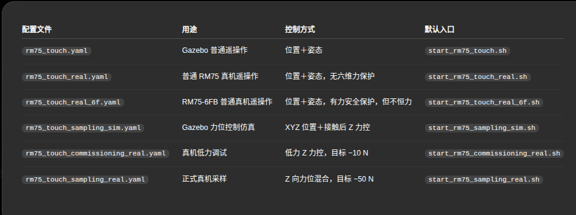

下面所有步骤都区分“宿主机”和“容器”，避免再次混淆路径。

## 一、进入运行环境

在宿主机终端执行：

```bash
docker start rm75_noetic
docker exec -it rm75_noetic bash
```

## 二、编译项目

```bash
source /opt/ros/noetic/setup.bash
cd /root/rm75_ws
catkin build geomagic_myhaptics rm75_touch_teleop
source /root/rm75_ws/devel/setup.bash
```

## 三、Touch 按键功能

- 灰键控制位置：
  - 按下时记录位置锚点；
  - 按住并移动 Touch，控制机械臂 XYZ；
  - 松开后保持最后位置。
- 白键控制姿态：
  - 按下时记录姿态锚点；
  - 按住并转动 Touch，控制末端姿态；
  - 松开后保持最后姿态。
- 两键可以分别使用，也可以同时使用。
- 两键都松开后停止发送新的机械臂指令。

坐标映射：

```text
机械臂 X = -Touch Z
机械臂 Y = -Touch X
机械臂 Z =  Touch Y
```

## 四、普通仿真遥操作

在容器内执行：

```bash
/root/rm75_ws/start_rm75_touch.sh
```

启动后等待约 3 秒，让机械臂到达初始姿态，然后操作 Touch。

另开一个宿主机终端，进入容器检查：
docker exec -it rm75_noetic bash
source /opt/ros/noetic/setup.bash
source /root/rm75_ws/devel/setup.bash
rosrun rm75_touch_teleop check_touch_teleop.sh

## 五、RM75-6FB 普通真机遥操作

当前机械臂是带六维力传感器的 RM75-6FB，推荐使用这个入口。

### 1. 观察模式启动

容器内执行：

```bash
/root/rm75_ws/start_rm75_touch_real_6f.sh
```

不带 `enable_motion:=true` 时，机械臂运动处于禁用状态，可用于检查通信和反馈。

默认地址：

```text
机械臂 IP：192.168.1.18
主机 UDP IP：192.168.1.100
UDP 坐标编号：1
```

### 2. 检查真机链路

另开一个宿主机终端：

docker exec -it rm75_noetic bash
source /opt/ros/noetic/setup.bash
source /root/rm75_ws/devel/setup.bash
rosrun rm75_touch_teleop check_rm75_real_6f.sh


手动检查：
```bash
rostopic hz /joint_states
rostopic hz /Geomagic/pose_raw
rostopic echo /Geomagic/joy
rostopic echo /rm_driver/UdpSixZeroForce
```

### 3. 启用真机运动
```bash
/root/rm75_ws/start_rm75_touch_real_6f.sh enable_motion:=true
```

## 六、力位控制仿真

容器内执行：

```bash
/root/rm75_ws/start_rm75_sampling_sim.sh
```

等待机械臂完成约 3 秒的初始化。

另开终端，进入容器后设置模拟土壤表面：

```bash
docker exec -it rm75_noetic bash
source /opt/ros/noetic/setup.bash
source /root/rm75_ws/devel/setup.bash
rosservice call /sampling_soil/set_surface '{}'
```

操作顺序：

1. 按住灰键缓慢向下接近模拟土壤。
2. 超过接触阈值后进入 `CONTACT_MODE`。
3. 接触后机械臂 Z 由力控制器调节。
4. 灰键继续控制水平位置。
5. 白键可独立控制姿态。
6. 松开灰键，冻结位置并退出接触力控。
7. 松开两个按键，停止发送控制命令。

查看状态：

```bash
rostopic echo /rm75_touch_teleop/control_mode
rostopic echo /rm75_touch_teleop/active
rostopic echo /rm75_touch_teleop/force_z
rostopic echo /rm75_touch_teleop/force_setpoint
rostopic echo /rm75_touch_teleop/stop_reason
```

## 七、真机低力调试

正式采样前，先使用低力模式验证方向和稳定性。

### 1. 观察模式

容器内执行：

```bash
/root/rm75_ws/start_rm75_commissioning_real.sh
```

默认配置：

```text
目标力：-10 N
力上限：20 N
力矩上限：2 N·m
Z 速度上限：2 mm/s
运动使能：关闭
```

另开终端检查：

```bash
docker exec -it rm75_noetic bash
source /opt/ros/noetic/setup.bash
source /root/rm75_ws/devel/setup.bash

rosrun rm75_touch_teleop check_rm75_real_6f.sh
rostopic echo /rm_driver/Udp_Coordinate
rostopic echo /rm_driver/UdpSixZeroForce
rostopic echo /rm75_touch_teleop/force_z
```

确认：

```text
/rm_driver/Udp_Coordinate = 1
```

### 2. 低力运动测试

停止观察模式后执行：

```bash
/root/rm75_ws/start_rm75_commissioning_real.sh enable_motion:=true
```

先做小行程、低速、低载荷接触测试。未验证力方向前，不要直接运行正式 −50 N 采样。

## 八、正式真机力位采样

### 1. 观察模式

```bash
/root/rm75_ws/start_rm75_sampling_real.sh
```

检查反馈、坐标系和力方向。

### 2. 启用运动

停止观察模式后执行：

```bash
/root/rm75_ws/start_rm75_sampling_real.sh enable_motion:=true
```

默认正式参数：

```text
目标力：-50 N
接触阈值：10 N
释放阈值：5 N
最大力：100 N
最大力矩：5 N·m
Z 速度上限：10 mm/s
最大接触 Z 行程：50 mm
```

正式参数必须在低力调试通过后使用。

## 九、正确停止程序

正常停止时，在运行 roslaunch 的容器终端按：

```text
Ctrl+C
```

不要按：

```text
Ctrl+Z
```

`Ctrl+Z` 只是挂起 roslaunch，驱动和控制节点可能仍在运行。

如果终端关闭、误按 `Ctrl+Z` 或出现：

```text
FAIL: conflicting live node exists
```

在宿主机直接执行：

```bash
docker exec -it rm75_noetic bash -lc '/root/rm75_ws/stop_rm75_touch.sh'
```

或者先进入容器：

```bash
docker exec -it rm75_noetic bash
/root/rm75_ws/stop_rm75_touch.sh
```

成功时显示：

```text
PASS: RM75/Touch control stack stopped.
```

如果停止后执行 `rosnode list` 显示：

```text
ERROR: Unable to communicate with master!
```

这是正常的，说明 ROS Master 也已经关闭。下一次启动会自动重新创建。

----------------下降取土------------------------
/root/rm75_ws/start_rm75_vertical_press_real.sh \
  enable_motion:=true \
  direct_press_speed:=0.8

## 十、SAFE_STOP 处理

查看停止原因：

```bash
rostopic echo /rm75_touch_teleop/stop_reason
rostopic echo /rm75_touch_teleop/control_mode
```

恢复步骤：

1. 立即松开灰键和白键。
2. 确认机械臂停止。
3. 排除超力、反馈超时、坐标错误或 IK 错误。
4. 确认力和关节反馈恢复。
5. 重新按键建立锚点。

如果机械臂可能仍在运动，优先使用物理急停，不要只依赖软件停止。

完整说明：

- [普通遥操作说明](/home/zjh/project/RealMan/rm75_ws/src/rm75_touch_teleop/README.md)
- [力位控制说明](/home/zjh/project/RealMan/rm75_ws/src/rm75_touch_teleop/docs/采样力位混合控制使用说明.md)
- [真机调试说明](/home/zjh/project/RealMan/rm75_ws/src/rm75_touch_teleop/docs/真机调试与使用-20261004.md)




-----------------------------bug--------------------------------------------
查询限位
/home/zjh/project/RealMan/realman_limit_recovery.py 
修复限位bug
/home/zjh/project/RealMan/realman_limit_recovery.py --recover --yes
------------------末端通电----------------
rosrun rm_driver set_tool_voltage.py 24


rosrun rm_driver set_tool_voltage.py 0


-------------------------吸末端执行器---------

抓
rosrun rm_driver tool_voltage_roundtrip.py \
  --speed 0.90 \
  --motion-timeout 120 \
  --execute

放
rosrun rm_driver tool_voltage_off_roundtrip.py \
  --speed 0.90 \
  --motion-timeout 120 \
  --execute


--------------------------------------手眼标定------------------------------------

translation:
  x: 0.024188514
  y: 0.090747103
  z: 0.025447015
rotation:
  x: -0.490470454
  y: -0.513848834
  z: -0.495183438
  w: 0.500191436

parameters:
  eye_on_hand: true
  freehand_robot_movement: false
  move_group: arm
  move_group_namespace: /
  namespace: /rm75_d435i_high_precision_eye_on_hand/
  robot_base_frame: base_link
  robot_effector_frame: Link7
  tracking_base_frame: camera_link
  tracking_marker_frame: camera_marker
transformation:
  qw: 0.5001914363419274
  qx: -0.49047045364387526
  qy: -0.5138488336139114
  qz: -0.49518343803705034
  x: 0.02418851387922378
  y: 0.09074710310769298
  z: 0.025447015109483433
  ------------------------------------------------------------------------------------------


-----------------------------------------------------------
0：134.424,183.92,219.935,3.128,0.03,1.56
1 134.645,251.787,220.262,3.121,0.027,1.642
2  133.267,317.928,218.985,3.102,0.02,1.609
3 131.356,383.387,220.016,3.101,0,1.659
