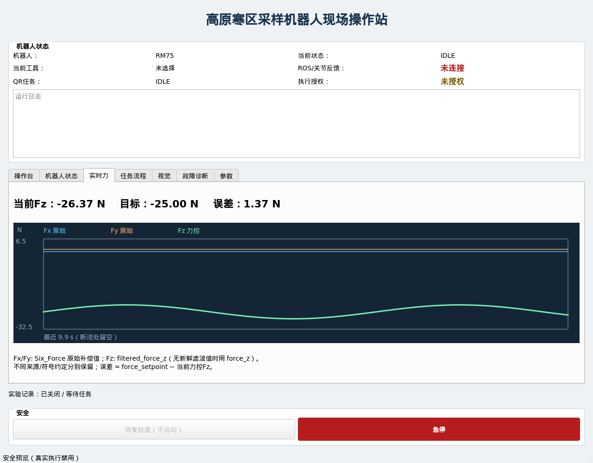
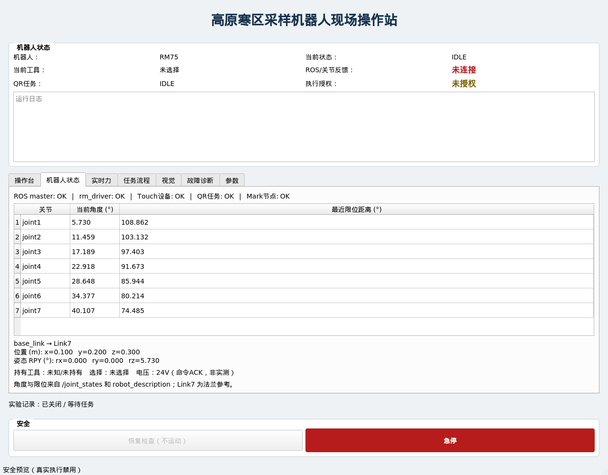

# 现场操作站升级交付记录

日期：2026-10-14。实现和验证环境：rm75_noetic / ROS1 Noetic / Python3 / PyQt5。

## 新增文件

以下路径均相对于 rm75_sampling_gui。

- `widgets/__init__.py`
- `widgets/status_widget.py`：节点、七关节、限位、TF、工具状态。
- `widgets/force_widget.py`：有界Fx/Fy/Fz曲线及目标/误差。
- `widgets/vision_widget.py`：RGB、Mark状态与位姿。
- `widgets/diagnostic_widget.py`：故障分类与去重历史。
- `widgets/parameter_widget.py`：YAML来源加载与只读参数表。
- `logger/__init__.py`
- `logger/experiment_logger.py`：异步CSV、状态日志、配置快照。
- `gui/__init__.py`
- `gui/main_window.py`：从ui迁移并扩展为七页现场操作站。
- `ros/monitoring.py`：有界ROS节点探测、URDF、TF、相机发现、消息新鲜度。
- `launch/station_offline.launch`
- `test/test_field_station.py`
- `test/test_monitor_transport.py`
- `test/monitor_transport.test`
- `assets/fonts/DroidSansFallbackFull.ttf`
- `assets/fonts/COPYRIGHT`
- `assets/fonts/LICENSE-Apache-2.0`
- `.gitignore`
- `docs/validation/FIELD_STATION.md`
- `docs/validation/station-force.png`
- `docs/validation/station-status.png`

## 修改文件

- `ui/main_window.py`：保留兼容导入。
- `ros/ros_interface.py`：接入只读Monitor，记录ACK，拒绝非有限力值，测量新鲜度与目标值分离。
- `task/task_manager.py`：急停/异常立即锁存；连续遥操作到识别不产生中间IDLE；工具选择约束；使用独立roslaunch子进程避免Qt工作线程信号处理限制。
- `scripts/sampling_gui.py`：offline入口、配置与来源快照、配置校验、信号关闭保护。
- `config/gui.yaml`：显示、接口、实验目录及参数映射。
- `CMakeLists.txt`、`setup.py`、`package.xml`：新增包目录、资源、依赖、测试安装声明。
- `README.md`：操作站说明、ROS接口和启动/记录规范。

StateMachine仅记录当前功能并保留SAFE_STOP锁存，不再限制普通功能之间的顺序；任务流程页面已移除。底层控制包未修改；当前状态已于2026-10-15同步到仓库根目录`PROJECT_FOR_CHATGPT.md`。

## ROS接口和启动

新增接口均为只读：

| 来源 | 内容 |
|---|---|
| /joint_states | JointState，七轴角度及源时间戳 |
| /robot_description | 参数中的URDF关节上下限 |
| /tf、/tf_static | base_link → Link7 |
| /rm_driver/UdpSixZeroForce | Six_Force原始补偿六维力；没有Header |
| /qr_task/marker_observation | Mark ID、6D位姿、frame_id、stamp |
| sensor_msgs/Image | 首选配置的RGB topic，否则自动发现color/rgb Image |

现有force_z、filtered_force_z、force_setpoint、vision_status、task_status及任务服务继续使用。PyQt GUI进程仍不发布JointPos；只有在受限七轴模式下启动的独立`joint_control_server`经过双层安全检查后，才可成为唯一的JointPos发布者。

在容器中执行：

```bash
source /opt/ros/noetic/setup.bash
cd /root/rm75_ws
catkin build rm75_sampling_gui --no-deps --no-status
source devel/setup.bash

# 无硬件、无Master，七页均可查看，所有控制禁用
rosrun rm75_sampling_gui sampling_gui.py --offline

# 接入已有基础栈；不重复启动QR节点
roslaunch rm75_sampling_gui gui_real.launch start_qr_task:=false

QT_QPA_PLATFORM=offscreen catkin run_tests rm75_sampling_gui --no-deps --no-status
catkin_test_results build/rm75_sampling_gui/test_results
```

执行授权仍默认false。图像/TF/参数缺失均显示不可用，不要求为了打开GUI先连接硬件。

## 测试结果

- catkin build（--no-deps）：成功，无构建警告。
- StateMachine：3个用例通过。
- TaskManager：5个用例通过。
- ACK合约：3个用例通过。
- 新现场操作站离线套件：15个用例通过。
- 新ROS transport：1个用例通过，独立rostest Master，动态RGB发现、TF、七轴、六维力、Mark位姿、断流均验证。
- 合计27个实际用例通过；catkin结果为28 tests / 0 errors / 0 failures / 0 skipped（包含rostest包装结果）。
- offline和real launch解析成功。
- Qt offscreen实际构建主窗口、切换状态/力页面并检查截图。中文字体缺失已通过包内字体解决。
- GUI发布器白名单测试通过；新Monitor/widgets/logger不包含控制发布器。

测试日志中的注入SAFE_STOP/ACK错误属于负向测试；Qt的XDG_RUNTIME_DIR提示不影响通过。
未启动真实rm_driver、Touch设备或真实相机，未发送机器人运动、电压、急停、清错等硬件命令。

## 模拟数据页面截图

截图数据来自测试fixture及正弦波，**不是实机采样结果**。




## 记录与后续建议

实验在进入活动任务时开始，在任务回到IDLE或SAFE_STOP时关闭。默认目录是包内experiments/YYYYMMDD_NNN；内容为robot_state.csv、force.csv、task.log、config.yaml。默认10Hz快照，CSV过期/未知值留空，保留新鲜度及可得的源时间戳。配置快照明确是YAML输入，不冒充外部launch覆盖后的有效控制参数。

建议下一阶段先增加已有实验CSV/rosbag只读回放和报告导出，再以现场只读数据验证断流告警、TF坐标和六维力单位。需要高频无损记录时另加独立记录链及时间同步；运行期有效参数审计、日志容量管理也可独立扩展。真实运动和单一命令源仲裁仍按原项目验收边界处理。
