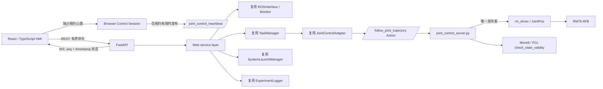

# RM75 Web 控制平台架构

## 边界

Web 化只替换 HMI，不重写机器人控制系统。浏览器不加载 `rospy`，不接受任意
topic/service/launch 名称，也不发布 `/rm_driver/JointPos`。所有运动仍经过现有
`TaskManager -> JointControlAdapter -> /rm75_sampling_gui/follow_joint_trajectory ->
joint_control_server.py -> /rm_driver/JointPos` 链。

ROS 回调在 `rospy` 自己的线程运行；FastAPI 的事件循环不直接执行阻塞 ROS/launch/
Action 调用，相关 REST handler 使用受控线程执行。状态快照会去除 ROS Image 对象和
非有限数，再以 10 Hz 有界覆盖方式发送，不建立无界消息队列。RGB 使用独立的最新帧
JPEG endpoint，浏览器按 D435i 当前 6 Hz 能力刷新。

## 控制会话与断联安全

- 同时只有一个浏览器能取得控制租约；监看连接数量不受限。
- 租约默认 650 ms，必须由与该租约绑定的 WebSocket 续期。
- HTTP 请求或服务端后台任务不能自行续租，也没有无限续期。
- 只有租约有效且 WebSocket 已绑定时，后端才向既有 ROS joint server 发送心跳。
- 浏览器关闭、网络中断或页面挂起后，续租停止；后端停止 ROS 心跳，既有 350 ms
  看门狗触发取消/软件急停/新 ACK 与静止确认。
- REST 执行、生命周期、工具电压和恢复均要求同一租约。离线模式无条件拒绝控制。

## 部署

生产模式由 FastAPI 统一提供构建后的前端，现场不需要常驻 Vite。服务默认只绑定
`127.0.0.1`。当前版本没有身份认证，因此入口拒绝绑定局域网或公网地址；若以后开放
远程访问，必须先增加 TLS、身份认证、角色授权、审计和现场网络访问控制。

技术选型相对建议的唯一调整是没有引入 Tailwind/shadcn：本平台使用小型 CSS token/
组件系统，减少 Noetic 现场镜像依赖和生成代码，同时保留 React、TypeScript、Vite、
Three/R3F、Recharts、Zustand、FastAPI、Pydantic 和 WebSocket。

## 纯内存仿真边界

`RM75_CONTROL_PATH=simulation` 使用与生产页面相同的 REST、WebSocket、控制租约和模型
接口，但命令在 `WebRuntime` 内存模拟分支终止。它不会执行 `ROSInterface.connect()`，
不会调用 `TaskManager` 的真实命令回调，也不会发布 ROS 控制心跳。模拟器按厂商 URDF
速度上限的一定比例跟踪七轴目标，并生成 FK TCP、六维力、AprilTag 0 状态及带醒目标记
的 RGB JPEG。急停会冻结目标并锁存 `SAFE_STOP`；恢复前其他功能命令返回 409。

SIMULATION、OFFLINE 与真实执行授权互斥。它用于 Web 集成和安全状态机回归，不是
Gazebo 动力学、MoveIt PlanningScene、硬件在环或真机安全验收的替代品。
